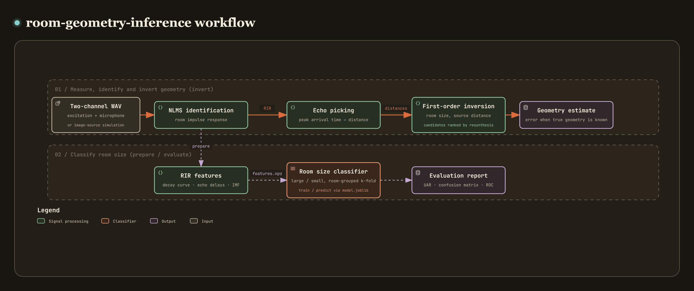

# room-geometry-inference

[](https://github.com/recklight/room-geometry-inference/actions/workflows/ci.yml)
[](https://www.python.org/downloads/)
[](LICENSE)

English | [繁體中文](README.zh-TW.md)

Infers the size of a room and the distance to the sound source from the echoes a single microphone records, mainly with the image-source method and adaptive filtering.

A measurement is a two-channel WAV file: one channel holds the excitation sent to the loudspeaker, the other the microphone recording. I first identify the room impulse response (RIR) from the two channels with an NLMS adaptive filter and convert the strongest echoes to distances. A first-order image-source model of a rectangular room then gives the room's width and depth, the source distance and the microphone position in closed form. There is more than one candidate solution, so each one is resynthesized as an impulse response and ranked by how well it matches the identified one. I also use the same impulse responses to train a large-room/small-room classifier (cross-validated with the recordings grouped by room) and to compare denoising methods, and I run a sensitivity analysis on timing offset, source bearing, source position and noise. The Python package is `room_geometry_inference` and the command-line tool is `room-geometry-inference`.

Author: RL

---

## Contents

- [Overview](#overview)
- [Method](#method)
- [Installation](#installation)
- [Quick start](#quick-start)
- [Usage](#usage)
- [CLI reference](#cli-reference)
- [Project layout](#project-layout)
- [Data preparation](#data-preparation)
- [Configuration](#configuration)
- [Results and metrics](#results-and-metrics)
- [Known limitations](#known-limitations)
- [Design notes](#design-notes)
- [Development and testing](#development-and-testing)
- [References](#references)
- [License](#license)

---

## Overview

[](https://raw.githack.com/recklight/room-geometry-inference/master/docs/workflow.html?theme=dark)

Interactive diagram: [view it online](https://raw.githack.com/recklight/room-geometry-inference/master/docs/workflow.html?theme=dark), or open [`docs/workflow.html`](docs/workflow.html) locally in a browser. You can zoom, search for a node and trace the path between any two steps.

A room's shape is hidden in its echoes. Each wall reflection arrives some time after the direct sound, and that delay times the speed of sound is the extra distance the sound traveled. Once you know which echo came from which wall, you can work the walls' positions back out (Dokmanić et al., 2011; Dokmanić et al., 2013; Antonacci et al., 2012). The trouble is that the recording does not say which echo came from which wall, and the impulse response first has to be estimated from a noisy recording. That is the geometric route. The other route gives up on exact geometry and classifies room size straight from the impulse response (Shabtai et al., 2010), or estimates room volume from speech (Genovese et al., 2019).

I take both routes here. The geometric inversion handles echo assignment with a closed-form solution (section 4). The room's symmetry makes 8 solutions exactly equivalent, and first-order echoes cannot determine the source bearing; section 5 explains both. The classifiers are cross-validated with the recordings grouped by room, so every test room is one the model never saw in training. Mono WAV reading, UAR and sensitivity/specificity come from [`speechdsp`](https://pypi.org/project/speechdsp/); every other step is in this package.

| Stage | What it does | Modules |
| --- | --- | --- |
| 1. Simulation | Impulse responses of 2-D and 3-D rectangular rooms by the image-source method; excitation signals, noise and two-channel measurement files | `image_source`, `excitation`, `recording` |
| 2. Identification | Impulse response estimated from excitation and recording with NLMS, LMS or least squares; learning curve and misalignment | `identification` |
| 3. Echoes | Peak picking (minimum spacing, spreading-loss compensation, sub-sample interpolation) and conversion to distance | `echoes` |
| 4. Inversion | Closed-form first-order solution, echo assignment, removal of symmetric duplicates, least-squares refinement, ranking by resynthesis | `inversion`, `geometry`, `room_estimation` |
| 5. Sensitivity | Sweeps over arrival-time offset, source bearing, source displacement and SNR | `sensitivity` |
| 6. Features and classification | Energy decay curve, echo arrival times, IMF energy and impulse-response magnitude; SVM, KNN, decision tree and echo template matching | `rir_features`, `emd`, `template_matching`, `models` |
| 7. Denoising | Comparison of linear correction, PCA, MLP and a PyTorch deep denoising autoencoder | `denoising`, `autoencoder` |
| 8. Evaluation and output | Stratified k-fold cross-validation grouped by room, metrics, figures, run folders and `manifest.json` | `evaluation`, `figures`, `pipeline`, `manifest`, `cli` |
| 9. Synthetic data | Two-channel measurements of large and small rooms with known geometry, for the tests, the examples and the quick start | `synthetic` |

---

## Method

### 1. Simulating room impulse responses with the image-source method

In a rectangular room, specular reflections off the walls are equivalent to a lattice of image sources (Allen & Berkley, 1979). Along one axis of length $L$, with the source at coordinate $s$, the image with index $k \in \mathbb{Z}$ sits at

$$x_k = (-1)^k s + \big(k + (k \bmod 2)\big) L ,$$

and has been reflected $|k|$ times on that axis: $\lfloor (|k| + [k<0])/2 \rfloor$ times off the wall at $x=0$ and the rest off the wall at $x=L$. If image $(k_x, k_y[, k_z])$ lies at distance $d$ from the microphone, its sound arrives at $\tau = d/c$ with amplitude

$$a = \frac{1}{d}\prod_w \beta_w^{\,n_w},$$

where $n_w$ is the number of reflections off wall $w$ and $\beta_w$ is that wall's reflection coefficient. A 2-D room is simulated as a true 2-D lattice (first order gives $3^2 = 9$ arrivals: the direct sound, 4 wall reflections and 4 corner reflections) and not as a 3-D room of height 0, which would add every in-plane image three times. Arrival times are either rounded to whole samples (a time exactly halfway between two samples goes to the later one) or kept as sub-sample delays with a Hann-windowed sinc (Peterson, 1986). The speed of sound is given directly or derived from air temperature, $c = 331.3\sqrt{1 + T/273.15}$ (Kinsler et al., 2000).

| Key | Default | Effect |
| --- | --- | --- |
| `acoustics.sample_rate` | `16000` | Sample rate for all processing (Hz); recordings at other rates are resampled first |
| `acoustics.speed_of_sound_m_s` | `343.0` | Speed of sound (m/s); derived from the temperature when `temperature_c` is set |
| `acoustics.temperature_c` | `null` | Air temperature (°C) |
| `acoustics.max_order` | `1` | Truncation order of the image lattice |
| `acoustics.order_mode` | `per_axis` | `per_axis`: $\lvert k_i \rvert \le N$ on each axis; `total`: $\sum_i \lvert k_i \rvert \le N$ |
| `acoustics.reflection` | `1.0` | Wall reflection coefficient |
| `acoustics.delay` | `integer` | `integer` or `fractional` (windowed sinc) |
| `acoustics.rir_taps` | `1600` | Length of the simulated impulse response (100 ms at 16 kHz) |

### 2. Identifying the impulse response from excitation and recording

The loudspeaker plays a known excitation $x[n]$ and the microphone records $d[n] = (h * x)[n] + v[n]$. An adaptive FIR filter $\mathbf{w}$ of length $N$, updated sample by sample with the regressor $\mathbf{x}_n = (x[n], \dots, x[n-N+1])$, converges to $h$ (system identification; Haykin, 2014). NLMS (Nagumo & Noda, 1967) is

$$e[n] = d[n] - \mathbf{w}_n^\top\mathbf{x}_n, \qquad \mathbf{w}_{n+1} = \mathbf{w}_n + \frac{\mu\, e[n]}{\varepsilon + \|\mathbf{x}_n\|^2}\,\mathbf{x}_n ,$$

where the normalization makes the step size independent of the excitation level; it is stable for $0 < \mu < 2$. LMS (Widrow & Hoff, 1960) has no normalization, so its step must stay below $2/(N\sigma_x^2)$; the code checks this first and raises an error instead of letting the filter diverge. Least squares gets the converged solution in one step: it estimates the autocorrelation and cross-correlation over the whole recording and solves the Toeplitz normal equations by Levinson recursion. Identification keeps only the final weights; to watch it converge, you can keep a snapshot of the weights at regular intervals. The full weight history of 2 s at 16 kHz with 1600 taps is 51.2 million float64 values, about 410 MB, and there is no need to keep all of it. The learning curve is an 80-sample moving average of the squared error, in dB; when the true response is known, the normalized misalignment $20\log_{10}(\|h-\hat h\|/\|h\|)$ is computed as well. The inversion, the `magnitude`/`imf_energy` features and the denoising comparison use the response after taking the absolute value, dividing by the peak and setting taps below `prune_threshold` to 0; `decay_curve` and `echo_delays` use the identified weights as they are.

| Key | Default | Effect |
| --- | --- | --- |
| `identification.method` | `nlms` | `nlms`, `lms` or `least_squares` |
| `identification.n_taps` | `1600` | Length of the identified impulse response; must cover the farthest first-order echo |
| `identification.step` | `0.8` | Step size: within (0, 2) for NLMS; for LMS it must be below the stability bound |
| `identification.regularization` | `1e-10` | Guard term in the NLMS denominator; diagonal loading for least squares |
| `identification.prune_threshold` | `0.001` | Taps below this fraction of the peak are set to 0 |

### 3. Echo picking and conversion to distance

The `peaks` method uses `scipy.signal.find_peaks` to find local maxima at least `min_separation_taps` apart, drops peaks below `relative_height` of the maximum and keeps the `n_echoes` strongest. The `top_k` method simply takes the `n_echoes` largest taps; one smeared echo can take several of the slots, so it is there only for comparison. A reflection's amplitude falls off as $1/d$ with path length $d$ while its delay grows in proportion to $d$, so `compensate_spreading` ranks peaks by amplitude × delay, which keeps a far wall from losing out to nearby noise. The threshold check still uses the unweighted amplitude, so estimation noise late in the response, which the weighting amplifies, does not slip in. Arrival times can optionally be refined to sub-sample precision with a three-point parabola. An arrival at sample $t$ (sample 0 is the moment the sound is emitted) converts to the distance $d = tc/f_s$.

| Key | Default | Effect |
| --- | --- | --- |
| `echoes.n_echoes` | `9` | Number of arrivals kept (direct sound included) |
| `echoes.method` | `peaks` | `peaks` or `top_k` |
| `echoes.min_separation_taps` | `3` | Minimum spacing between two peaks |
| `echoes.relative_height` | `0.02` | Peaks below this fraction of the largest amplitude are ignored |
| `echoes.interpolate` | `false` | Parabolic refinement to sub-sample precision |
| `echoes.compensate_spreading` | `true` | Rank by amplitude × delay |

### 4. Inverting first-order echoes for room size

Take a planar room $[0,W]\times[0,D]$ with the microphone at $(m_x, m_y)$ and the source displaced from the microphone by $(a, b) = d_0(\cos\theta, \sin\theta)$, where $d_0$ is the direct distance and $\theta$ the source bearing. With $u_x = 2m_x + a$ and $v_x = 2W - 2m_x - a$ ($u_y, v_y$ likewise), the four wall reflections travel

$$d_{x,\min}^2 = u_x^2 + b^2,\quad d_{x,\max}^2 = v_x^2 + b^2,\quad d_{y,\min}^2 = a^2 + u_y^2,\quad d_{y,\max}^2 = a^2 + v_y^2 ,$$

and the four corner reflections are $\sqrt{u_x^2+u_y^2}$ and the other three combinations. For a given bearing the four equations decouple and have the closed-form solution

$$m_x = \tfrac12\Big(\sqrt{d_{x,\min}^2 - b^2} - a\Big),\qquad W = m_x + \tfrac12\Big(a + \sqrt{d_{x,\max}^2 - b^2}\Big),$$

and likewise for $m_y, D$. Each square root has a positive and a negative branch, giving $2^4 = 16$ algebraic solutions. Since $u_x = m_x + s_x$ is the sum of two coordinates inside the room, only the positive branch can hold (`all_branches=True` computes all 16 and leaves the feasibility check to discard the other 15).

The recording does not label which echo came from which wall. The earliest arrival is taken as the direct sound, and every ordered choice of 4 of the remaining 8 echoes is tried as (x_min, x_max, y_min, y_max). That makes $8!/4! = 1680$ assignments, all solved at once as arrays, and solutions that put the room, microphone or source somewhere impossible are thrown out. The corner reflections serve as an overdetermined consistency check: each predicted corner is paired with the nearest echo and each unassigned echo with the nearest predicted corner, and the RMS error over both is the candidate's residual (each term counts at most 0.5 m, so one extra or missing echo cannot sink a candidate whose other arrivals all match). This is hypothesize-and-test echo labeling (Dokmanić et al., 2013). Levenberg–Marquardt then fits the room, the microphone position and the source distance jointly to all 9 arrivals. Fewer than 8 detected reflections mean that some arrivals have merged into one peak, and in that case one echo is allowed to stand for two walls.

| Key | Default | Effect |
| --- | --- | --- |
| `inversion.source_bearing_deg` | `45.0` | Assumed source bearing (see the next section) |
| `inversion.refine` | `true` | Least-squares fit to all 9 arrivals |
| `inversion.max_candidates` | `20` | Number of distinct candidates kept and resynthesized |

### 5. Symmetry, and why the bearing cannot be identified

**Equivalent layouts.** An image distance is the hypotenuse of the per-axis displacements, and along an axis of length $L$ the set of image displacements $\{(s-m) + 2kL,\ -(s+m) + 2kL\}$ stays the same under four transformations: the identity, a mirror ($m \to L-m$, $s \to L-s$), swapping the source and microphone coordinates on that axis, and mirror plus swap. Applied to each axis independently, and combined with swapping the x and y axes, they give 32 layouts with exactly the same impulse response (when every wall has the same reflection coefficient). Eight of them keep the 45° bearing, so the 45° model always has 8 equally good solutions. The code removes duplicates through a canonical form (the longer side as the width, lexicographically smallest coordinates), and `n_equivalent` records how many solutions were merged. Room size and source distance are identifiable; the absolute microphone position is determined only up to these symmetries. Size errors are always computed on the sorted side lengths, $\sum_i|\hat L_{(i)} - L_{(i)}|$, so a swap of the width and depth names is not counted as an error and positive and negative errors cannot cancel.

**First-order echoes do not determine the bearing.** Every corner distance follows from two walls and the direct sound:

$$d_{x,\min+y,\min}^2 = d_{x,\min}^2 + d_{y,\min}^2 - d_0^2 ,$$

and the same holds for the other three corners. The corners can check the echo assignment but carry no information about $\theta$: the closed-form solution reproduces the 9 arrivals exactly for any bearing. First-order arrivals therefore pin the room down only to a one-parameter family

$$W(\theta) = \tfrac12\Big(\sqrt{d_{x,\min}^2 - b^2} + \sqrt{d_{x,\max}^2 - b^2}\Big),\qquad b = d_0\sin\theta ,$$

and the bearing has to be known or assumed (45° by default). A wrong assumption costs only a second-order term, $W \approx \tfrac12(d_{x,\min} + d_{x,\max}) - \tfrac{b^2}{4}(d_{x,\min}^{-1} + d_{x,\max}^{-1})$, which gets smaller the closer the source is to the microphone and the farther it is from the walls. `bearing_family()` lists the whole family.

### 6. Ranking candidates by resynthesis

Each candidate layout is resynthesized as an impulse response with the same image-source settings and compared with the observation. The default, `tap_match`, counts the predicted arrivals with no observed echo within `tolerance_taps` and the observed echoes with no predicted arrival nearby, as a fraction of all arrivals. It is insensitive to rounding of the arrival times, and ties go to the smaller residual. `l1` and `l2` compare peak-normalized amplitudes sample by sample instead, but they are very sensitive to a one-sample shift: with rounded arrivals in a small room at 10 kHz, `l1` picks the wrong room and `tap_match` the right one (the tests include this case).

| Key | Default | Effect |
| --- | --- | --- |
| `inversion.rank_metric` | `tap_match` | `tap_match`, `l1` or `l2` |
| `inversion.tolerance_taps` | `2.0` | Arrival tolerance for `tap_match` (samples) |

### 7. Sensitivity analysis

There are four sweeps, all centered on the scene in the `room` section, and the results go into one table with a row per estimate:

- `delay_offset`: the same time offset (fractional samples allowed) added to every arrival, which is what an uncompensated playback delay does.
- `source_bearing`: the source moves around the microphone at the same distance while the inversion keeps the assumed bearing, which measures what a wrong 45° assumption costs.
- `source_shift`: the source is displaced along the x and y axes.
- `snr`: the whole chain (simulated recording → NLMS → echo picking → inversion → ranking), `n_trials` times at each SNR.

Noise is added with the closed-form gain $g = \sqrt{P_s / (P_n 10^{\mathrm{SNR}/10})}$, so the measured SNR equals the configured one exactly. `room_error_m` is the summed absolute error of the sorted side lengths, and `tap_shift` the mean shift of the arrival times from the reference (computed after optimal matching, so one missing or extra echo does not throw every later arrival out of line).

| Key | Default | Effect |
| --- | --- | --- |
| `sensitivity.sweeps` | all four | Sweeps to run |
| `sensitivity.delay_offsets_samples` | `[0, 0.2, 0.5, 1, 2, 5, 10, 30]` | Arrival-time offsets (samples) |
| `sensitivity.bearings_deg` | `[5, 15, …, 85]` | True source bearings |
| `sensitivity.shifts_m` | `[-0.5, …, 0.5]` | Source displacement along x and y |
| `sensitivity.snr_db` | `[-5, 0, 5, 10, 20, 30]` | Signal-to-noise ratios |
| `sensitivity.n_trials` | `10` | Repetitions per SNR (different noise each time) |

### 8. Room-size classification

The impulse response identified from each measurement is described in one of four ways before it goes to a classifier:

- `magnitude`: the peak-normalized amplitude with values below the threshold set to zero (one value per tap).
- `decay_curve`: the Schroeder backward-integrated energy decay curve (Schroeder, 1965), $E(t) = 10\log_{10}\big(\sum_{\tau \ge t} h^2(\tau) / \sum_\tau h^2(\tau)\big)$, floored at `floor_db`. The curve is monotonic, so when the echoes move a little the curve moves only a little, and rooms of similar size get similar curves.
- `echo_delays`: arrival times (ms) of the `n_echoes` strongest echoes.
- `imf_energy`: the energy fraction and zero-crossing rate of each IMF from empirical mode decomposition (EMD; Huang et al., 1998), plus the energy fraction of the residue. The envelopes are cubic splines with mirrored end points (Rilling et al., 2003), and sifting stops when the normalized squared difference between consecutive candidates falls below `emd_tolerance`; the three-threshold criterion (Rilling et al., 2003) and a fixed number of siftings (Wu & Huang, 2009) are available too. Both the number of siftings and the number of IMFs are capped, so it can never loop forever.

The classifiers are an RBF-kernel support vector machine (Cortes & Vapnik, 1995), k-nearest neighbors (Cover & Hart, 1967; votes weighted by inverse distance), a CART decision tree (Breiman et al., 1984) and echo template matching. The template matcher stores the echo arrival pattern of every training response, and the match score of a new response is the fraction of its echoes that fall within `template_tolerance_taps` of a template's echoes. In `predict`, a measurement whose best score is below `template_min_score` gets `unknown` and can go straight to `invert`; cross-validation in `evaluate` always takes the best class. Every step that learns parameters from the data, such as standardization, sits inside a scikit-learn `Pipeline` (Pedregosa et al., 2011) and is fitted on the training folds only. Evaluation is stratified k-fold cross-validation grouped by room (Kohavi, 1995) with UAR as the main metric (Schuller et al., 2009), plus sensitivity, specificity and ROC-AUC (Fawcett, 2006) when there are two classes. `prepare --svmlight` also exports the features in the LIBSVM sparse text format (Chang & Lin, 2011) for use in other tools.

| Key | Default | Effect |
| --- | --- | --- |
| `features.representation` | `decay_curve` | `magnitude`, `decay_curve`, `echo_delays` or `imf_energy` |
| `features.floor_db` | `-60.0` | Floor of the decay curve (dB) |
| `features.max_imfs` | `6` | Number of IMFs that `imf_energy` describes |
| `features.emd_tolerance` | `0.3` | Stopping threshold for EMD sifting |
| `model.name` | `svm` | `svm`, `knn`, `tree` or `template` (`template` needs `magnitude`) |
| `model.svm_c` | `10.0` | SVM penalty parameter |
| `model.svm_gamma` | `scale` | RBF kernel width: `scale`, `auto` or a positive number |
| `model.n_neighbors` | `5` | Number of neighbors for KNN |
| `model.tree_max_depth` | `null` | Maximum depth of the decision tree; `null` for no limit |
| `model.template_tolerance_taps` | `2.0` | Arrival tolerance for template matching |
| `model.template_min_score` | `0.7` | Below this match score the answer is `unknown` (`predict` only; `evaluate` always takes the best class) |

### 9. Denoising impulse responses

The identified $|\hat h|$ sits on a layer of estimation noise, while the true $h$ is a few echoes with zeros everywhere else. A denoiser learns the mapping from the first to the second and is scored by the per-response $\mathrm{MSE_{dB}} = 10\log_{10}\frac1N\sum_t (h[t] - \tilde h[t])^2$. The candidates are `identity` (no processing; every method has to beat it), `linear` (a least-squares correction with one gain and one offset shared by all taps), `pca` (projection onto the principal subspace of the clean training responses; Pearson, 1901), `mlp` (a scikit-learn multilayer perceptron with inputs and targets standardized per tap, i.e. a denoising autoencoder; Vincent et al., 2008; Lu et al., 2013), and `deep_autoencoder`, the same idea in PyTorch. It is trained with Adam (Kingma & Ba, 2015) and keeps the standardization parameters as buffers of the network; set `denoising.device=cuda` to train larger networks on the GPU. All methods share the same room-grouped k-fold splits, so every room is denoised by a model that has never seen it, and a lookup table that only memorizes the training rooms would fail.

| Key | Default | Effect |
| --- | --- | --- |
| `denoising.methods` | `[identity, linear, pca, mlp]` | Methods to compare; `deep_autoencoder` needs the `dl` extra |
| `denoising.architectures` | `[[300, 300, 300]]` | Hidden-layer widths; each network method is evaluated once per architecture |
| `denoising.activation` | `logistic` | `logistic`, `relu` or `tanh` |
| `denoising.n_epochs` | `300` | Training epochs |
| `denoising.learning_rate` | `0.001` | Adam step size |
| `denoising.batch_size` | `32` | Mini-batch size |
| `denoising.weight_decay` | `0.0001` | L2 penalty |
| `denoising.n_components` | `10` | Principal components kept by `pca` |
| `denoising.device` | `cpu` | `cpu` or `cuda` (`deep_autoencoder`) |

### 10. Synthetic data

The `synthetic` section controls the synthetic data that the `synthesize` command and the tests use. Each class is a nominal room size (by default `large`, 10.7 × 7.5 m, and `small`, 3.5 × 3.0 m). Each class gets `n_rooms_per_class` different rooms with side lengths drawn uniformly within ± `room_jitter_m` of the nominal size, and each room is measured `n_recordings_per_room` times with the microphone and source placed anew every time: the direct distance is drawn from `source_distance_range_m`, the source lies in the `source_bearing_deg` direction from the microphone, and both stay at least `wall_margin_m` from the walls. For every measurement, the `excitation` signal (white noise by default; pink noise, speech-like noise, babble and a pure tone are also available) goes through the room's image-source impulse response, noise is added at `snr_db`, and the result is written as a two-channel 16-bit WAV. The geometry is rounded to the millimeter before simulation, so the values written to `dataset.csv` are exactly the ones simulated; each room is one `group`.

Rooms within a class differ from each other, and the positions differ between measurements of the same room, so a classifier only scores if it generalizes to rooms it has not seen. The measurements have exactly the format of real data and come with the true geometry, so `invert` and `denoise` can compute their errors directly. The same seed writes byte-identical files.

| Key | Default | Effect |
| --- | --- | --- |
| `synthetic.class_names` | `[large, small]` | Class names, one for each entry of `room_sizes_m` |
| `synthetic.room_sizes_m` | `[[10.7, 7.5], [3.5, 3.0]]` | Nominal `[width, depth]` of each class (m) |
| `synthetic.room_jitter_m` | `0.3` | Sampling range of the side lengths |
| `synthetic.n_rooms_per_class` | `8` | Rooms per class (the cross-validation groups) |
| `synthetic.n_recordings_per_room` | `3` | Measurements per room |
| `synthetic.source_distance_range_m` | `[0.8, 1.6]` | Range of the direct distance |
| `synthetic.source_bearing_deg` | `45.0` | Source bearing |
| `synthetic.wall_margin_m` | `0.3` | Minimum distance from the walls |
| `synthetic.excitation` | `white` | `white`, `pink`, `speech_like`, `babble` or `sine` |
| `synthetic.duration_s` | `2.0` | Length of each measurement (s) |
| `synthetic.snr_db` | `30.0` | SNR at the microphone; `null` for no noise |
| `synthetic.noise` | `white` | `white`, `pink`, `babble` or `sine` |

The single scene for `simulate` and `sensitivity` is set in the `room` section (by default 10.7 × 7.5 m, with the microphone at the center (5.35, 3.75) and the source at (6.35, 4.75)); excitation, length and noise come from the `synthetic` section.

---

## Installation

Requires Python 3.10 or later.

```bash
git clone https://github.com/recklight/room-geometry-inference.git
cd room-geometry-inference
python -m venv .venv
# Windows: .venv\Scripts\activate    Linux/macOS: source .venv/bin/activate
pip install -e .                 # core (also installs speechdsp from PyPI)
pip install -e ".[dl]"           # PyTorch models (optional)
pip install -e ".[dev]"          # development tools: pytest, ruff
```

Without the `dl` extra, everything except the `deep_autoencoder` denoiser works (simulation, identification, inversion, sensitivity analysis, classification, the other denoisers, figures). Asking for `deep_autoencoder` gives an error message that tells you to run `pip install -e ".[dl]"` in the project folder. You can also skip installation and run `PYTHONPATH=src python -m room_geometry_inference --help` from inside the project folder.

---

## Quick start

No data needed; the first command generates a synthetic dataset.

```bash
# 1. Generate a synthetic dataset
room-geometry-inference synthesize --config configs/quick_demo.yaml --out data/synthetic
# 2. Prepare the model inputs from the dataset index
room-geometry-inference prepare --config configs/quick_demo.yaml --out outputs/demo/prepare
# 3. Cross-validate
room-geometry-inference evaluate outputs/demo/prepare/features.npz --config configs/quick_demo.yaml --out outputs/demo/evaluate
# 4. Train on all the data
room-geometry-inference train outputs/demo/prepare/features.npz --config configs/quick_demo.yaml --out outputs/demo/train
# 5. Predict on a new input file
room-geometry-inference predict data/synthetic/small/small_000.wav --model outputs/demo/train/model.joblib --out outputs/demo/predict
```

Or run the whole chain in one go: `python examples/end_to_end_synthetic.py`. To see the room-geometry inversion: `room-geometry-inference simulate --out outputs/demo/simulate`.

> The quick start reaches a UAR of 1.000 (see [Results and metrics](#results-and-metrics)), but the synthetic measurements are planar rooms with `acoustics.max_order: 1`: only 9 arrivals each, with no floor, ceiling, furniture or higher-order reflections. All this shows is that the pipeline runs, not that real rooms can be told apart this accurately.

---

## Usage

### CLI

```bash
# 1. Build a dataset index from a <folder>/<class>/<file>.wav layout, then change the group column to room IDs
room-geometry-inference index data/rooms
# 2. Identify each measurement's impulse response and compute the energy decay curve (48 kHz measurements are resampled first)
room-geometry-inference prepare --dataset data/rooms/dataset.csv --set identification.n_taps=2400 --out outputs/rooms/prepare
# 3. 5-fold cross-validation grouped by room; the feature settings must match those of prepare
room-geometry-inference evaluate outputs/rooms/prepare/features.npz --set identification.n_taps=2400 --seed 1 --out outputs/rooms/evaluate
# 4. Train on all the data and save the model, then predict on a new measurement
room-geometry-inference train outputs/rooms/prepare/features.npz --set identification.n_taps=2400 --out outputs/rooms/train
room-geometry-inference predict new/take_01.wav --model outputs/rooms/train/model.joblib --out outputs/rooms/predict
# 5. Invert every measurement directly for room size and source distance (errors too, when dataset.csv has geometry columns)
room-geometry-inference invert --dataset data/rooms/dataset.csv --set identification.n_taps=2400 --out outputs/rooms/invert
# 6. Room at 26 °C, source directly to the right of the microphone (bearing 0°)
room-geometry-inference invert new/take_01.wav --set acoustics.temperature_c=26 --set inversion.source_bearing_deg=0 --out outputs/rooms/invert_one
```

I keep the settings that don't change in my own YAML file (for example `configs/my_rooms.yaml`, listing only the keys that differ from the defaults; `configs/my_*.yaml` is kept out of version control) and pass it with `--config`, so I don't have to repeat `--set` on every command. `--set` values are parsed as JSON, so a list is written as `--set 'denoising.methods=["identity","pca"]'`.

### Python API

```python
import numpy as np

from room_geometry_inference import (
    Config,
    bearing_family,
    best_estimate,
    cross_validate,
    first_order_distances,
    image_source_rir,
    invert_echoes,
    prepare_features,
    simulate_scene,
    write_synthetic_dataset,
)

# 1. Low-level function: first-order impulse response of a 10.7 x 7.5 m room, 9 arrival samples (16 kHz)
result = image_source_rir([10.7, 7.5], [6.35, 4.75], [5.35, 3.75], sample_rate=16_000)
print(result.arrival_taps())  # [ 66 307 399 455 545 548 602 624 675]

# 2. Inversion from exact echo distances: room, source distance and 8 equivalent solutions
distances = first_order_distances(10.7, 7.5, 5.35, 3.75, 1.0, 1.0)
estimate = best_estimate(invert_echoes(distances))
print([round(side, 3) for side in estimate.size_m], round(estimate.source_distance_m, 3), estimate.n_equivalent)  # [10.7, 7.5] 1.414 8

# 3. The bearing is not identifiable: every bearing reproduces the 9 arrivals exactly, with a slightly different room
family = bearing_family(distances, bearings_deg=[15.0, 45.0, 75.0])
print(family["width_m"].round(3).tolist())  # [10.741, 10.7, 10.659]

# 4. The whole chain: simulated recording → NLMS → echoes → inversion
config = Config()
scene = simulate_scene(config, rng=0)
print([round(side, 3) for side in scene.inversion.estimate.size_m], round(scene.misalignment_db, 1))  # [10.704, 7.501] -31.9

# 5. Synthetic data → decay curves → cross-validation grouped by room
config = Config.from_yaml("configs/quick_demo.yaml")
index = write_synthetic_dataset("data/synthetic", config.synthetic, rng=config.seed)
features = prepare_features(index, config)
uar = cross_validate(features, config).metrics["summary"]["uar"]
print(f"{uar['mean']:.3f} +/- {uar['std']:.3f}")  # 1.000 +/- 0.000
```

### Example scripts

| Script | What it shows | Run time |
| --- | --- | --- |
| `examples/end_to_end_synthetic.py` | Synthetic data → decay curves → room-grouped cross-validation → training and saving → loading and predicting, all through the public API | about 7 s (`--quick` about 3 s) |
| `examples/invert_simulated_room.py` | Simulation, identification and inversion of a large and a small reference room, and the bearing family of the large room | about 2 s (`--quick` about 2 s) |
| `examples/sweep_inversion_sensitivity.py` | The four sweeps (timing offset, bearing, source displacement and SNR), as tables and error-bar plots | about 11 s (`--quick` about 3 s) |
| `examples/compare_rir_denoisers.py` | Room-grouped comparison of the denoisers at 5 dB SNR; adds the deep autoencoder when PyTorch is installed (not with `--quick`) | about 33 s (`--quick` about 4 s) |
| `examples/compare_feature_representations.py` | UAR on unseen rooms for the four features × each classifier, as a table and a bar chart | about 9 s (`--quick` about 5 s) |

Every script takes `--out`, `--seed` and `--quick`, and writes to `examples/output/<script name>/` by default.

---

## CLI reference

| Command | Purpose | Main input | Main output |
| --- | --- | --- | --- |
| `synthesize` | Writes synthetic measurements with known geometry, in the same format as real data | config | `<out>/<class>/<class>_<NNN>.wav`, `dataset.csv` |
| `index` | Builds a dataset index from `<folder>/<class>/<file>.wav` | folder | `<folder>/dataset.csv` |
| `prepare` | Identifies the impulse response of each measurement and computes the features | `dataset.csv` | `features.npz`, `items.csv` (plus `features.svm` with `--svmlight`) |
| `evaluate` | Stratified k-fold cross-validation grouped by room | `features.npz` | `metrics.json`, `folds.csv`, `predictions.csv`, confusion matrix and ROC figures |
| `train` | Trains once on all measurements and saves the model | `features.npz` | `model.joblib` |
| `predict` | Predicts new measurements with a model file, using only the settings stored in it | WAV files, model file | `predictions.csv` |
| `simulate` | Simulates the `room` scene, identifies the impulse response and inverts for the room | config (optionally a mono WAV via `--excitation`) | `images.csv`, `recording.wav`, `impulse_response.*`, `learning_curve.*`, `candidates.csv`, `estimate.json` |
| `invert` | Infers room size and source distance from measurements | WAV files or `dataset.csv` | `estimates.csv`; plus `room_estimates.*` when the true geometry is known |
| `sensitivity` | Timing offset, bearing, source displacement and SNR sweeps | config | `sensitivity.csv`, `sensitivity_summary.csv`, `sensitivity_<sweep>.*` |
| `denoise` | Compares impulse-response denoisers with room-grouped cross-validation | `dataset.csv` with geometry columns | `denoising_scores.*`, `denoising_summary.csv` |

| Option | Commands | Description |
| --- | --- | --- |
| `--log-level LEVEL` | global (before the subcommand) | `DEBUG`, `INFO` (default), `WARNING` or `ERROR`; logs go to stderr |
| `--version` | global | Prints the version and exits |
| `--config/-c PATH` | every command except `index` and `predict` | YAML config file; the defaults apply when it is omitted |
| `--set/-s KEY=VALUE` | as above | Overrides one setting, e.g. `--set model.name=knn`; the value is parsed as JSON; repeatable |
| `--seed INT` | `synthesize`, `evaluate`, `train`, `simulate`, `sensitivity`, `denoise` | Same as `--set seed=INT` |
| `--dataset/-d PATH` | `prepare`, `invert`, `denoise` | Same as `--set data.dataset=PATH` |
| `--out/-o PATH` | every command that writes files, except `index` | Output folder; when omitted, `<command>_<UTC time>` is created under `output.root` (`synthesize` defaults to `data/synthetic`) |
| `--model/-m PATH` | `predict` | Model file written by `train` (required) |
| `--svmlight/--no-svmlight` | `prepare` | Whether to also export the LIBSVM sparse text format (off by default) |
| `--excitation PATH` | `simulate` | Use this mono WAV as the excitation instead of synthesizing one |
| `--force` | `index` | Overwrite an existing `dataset.csv`; without it the file is kept and an error is raised, so a hand-edited `group` or geometry column is never overwritten |

Exit codes: `0` means success; `2` means a problem with the input or the configuration (only a one-line `error: ...` is printed; add `--log-level DEBUG` for the full traceback); `1` means an interruption or a bug in the program itself.

---

## Project layout

```text
room-geometry-inference/
├── .github/
│   ├── ISSUE_TEMPLATE/
│   │   ├── bug_report.yml               # bug report form
│   │   ├── config.yml                   # disables blank issues
│   │   └── feature_request.yml          # feature request form
│   └── workflows/
│       └── ci.yml                       # lint, 3.10 syntax gate, Linux/Windows × Python 3.10–3.13, oldest dependencies, PyTorch
├── configs/
│   ├── default.yaml                     # identical to Config(), with a comment on every key
│   ├── quick_demo.yaml                  # small synthetic dataset, finishes in seconds
│   └── similar_rooms.yaml               # two room classes of similar depth and different length (harder to classify)
├── data/
│   └── .gitkeep                         # default location for data; contents are not tracked
├── outputs/
│   └── .gitkeep                         # default root of the run folders; contents are not tracked
├── docs/
│   ├── images/workflow.png              # workflow diagram shown in this README
│   ├── images/workflow.zh-TW.png        # the same diagram in Traditional Chinese
│   ├── workflow.html                    # interactive workflow diagram (open in a browser)
│   └── workflow.zh-TW.html              # the interactive diagram in Traditional Chinese
├── examples/
│   ├── end_to_end_synthetic.py          # end-to-end run
│   ├── invert_simulated_room.py         # inversion of the reference rooms and the bearing family
│   ├── sweep_inversion_sensitivity.py   # the four sensitivity sweeps
│   ├── compare_rir_denoisers.py         # denoiser comparison
│   └── compare_feature_representations.py  # features × classifiers comparison
├── src/
│   └── room_geometry_inference/
│       ├── __init__.py                  # public API
│       ├── __main__.py                  # python -m room_geometry_inference
│       ├── py.typed                     # marker for type information
│       ├── cli.py                       # typer command line
│       ├── config.py                    # config dataclasses, YAML reading and writing
│       ├── errors.py                    # exception classes
│       ├── logging_utils.py             # logging setup
│       ├── manifest.py                  # run folders and manifest.json
│       ├── dataset.py                   # dataset.csv, features.npz and LIBSVM export
│       ├── synthetic.py                 # synthetic measurements with known geometry
│       ├── image_source.py              # image-source simulation of impulse responses
│       ├── excitation.py                # excitation and interference signals
│       ├── recording.py                 # reverberation, noise at an exact SNR, two-channel WAV
│       ├── identification.py            # NLMS, LMS and least-squares identification, learning curve and misalignment
│       ├── echoes.py                    # echo picking and conversion to distance
│       ├── geometry.py                  # equivalent layouts and size error
│       ├── inversion.py                 # closed-form solution, echo assignment, refinement, ranking, bearing family
│       ├── room_estimation.py           # full chain from recording to room estimate
│       ├── sensitivity.py               # sensitivity sweeps
│       ├── emd.py                       # empirical mode decomposition
│       ├── rir_features.py              # the four impulse-response features
│       ├── template_matching.py         # echo template matching
│       ├── denoising.py                 # denoisers and their comparison
│       ├── autoencoder.py               # PyTorch deep denoising autoencoder (imported lazily)
│       ├── models.py                    # classifier registry and model files
│       ├── pipeline.py                  # high-level prepare/train/predict/invert/denoise functions
│       ├── evaluation.py                # grouped cross-validation and metrics
│       └── figures.py                   # figures and their matching tables
├── tests/                               # test_<module>.py for each module, plus checks on the examples, 3.10 compatibility and the docs
├── .gitattributes
├── .gitignore
├── CHANGELOG.md                         # in Traditional Chinese
├── CITATION.cff
├── CONTRIBUTING.md                      # in Traditional Chinese
├── LICENSE
├── README.md
├── README.zh-TW.md
└── pyproject.toml
```

---

## Data preparation

The repository comes with no measurements. Put your own two-channel measurements under `data/` (not tracked) or anywhere outside the project, and point `data.dataset` (or `--dataset`) at their `dataset.csv`. If you have no measurements yet, `synthesize` writes synthetic data in exactly the same format.

### 1. Dataset index: dataset.csv

| Column | Required | Description |
| --- | --- | --- |
| `path` | yes | Path of the measurement WAV file, relative to the folder that holds `dataset.csv`, separated by `/` (`\` is accepted too) |
| `label` | for classification | Room class, e.g. `large`, `small`; `invert` and `denoise` do not need it |
| `group` | no | Room ID. All measurements of a room always end up in the same fold; without this column every measurement is a group of its own |
| `room_width_m`, `room_depth_m`, `mic_x_m`, `mic_y_m`, `source_x_m`, `source_y_m` | no (all six or none) | True planar geometry (m), with the room spanning `[0, width] × [0, depth]`; `invert` uses it to compute errors and `denoise` to simulate the clean target response |

```csv
path,label,group,room_width_m,room_depth_m,mic_x_m,mic_y_m,source_x_m,source_y_m
large/take_001.wav,large,lecture_hall,10.7,7.5,5.35,3.75,6.35,4.75
large/take_002.wav,large,lecture_hall,10.7,7.5,3.10,2.20,4.10,3.20
small/take_001.wav,small,office_3f,3.5,3.0,1.75,1.50,2.75,2.50
```

File names carry no meaning; label, group and geometry are read from the columns only. If the measurements already sit in one subfolder per class, `room-geometry-inference index <folder>` writes a `dataset.csv` (one group per measurement), and all that is left is to change `group` to room IDs. `index` does not overwrite a `dataset.csv` that is already in the folder; add `--force` to rebuild it. If files listed in the index do not exist, the program lists the first 5 missing paths and stops.

### 2. Measurement file format

| Item | Requirement and handling |
| --- | --- |
| Container | RIFF/WAVE; 8-, 16- or 32-bit integer or floating-point PCM |
| Channels | **Two channels**: channel 0 is the excitation sent to the loudspeaker (ideally recorded through the sound card's loopback, so that the playback delay cancels out), channel 1 is the microphone; a mono file is rejected with an explanation |
| Sample rate | Any; both channels are resampled to `acoustics.sample_rate` (16 kHz by default) with a polyphase filter |
| Length | Must be longer than `identification.n_taps`; with white-noise excitation, use at least 1–2 s; speech-like excitation converges slowly and needs longer |
| Excitation | White or pink noise is ideal; a pure tone excites a single frequency and cannot identify the whole impulse response |
| Response length | `identification.n_taps / sample_rate × c` must exceed the farthest first-order echo path (about twice the room diagonal); the default 1600 taps at 16 kHz cover about 34 m |

The two channels must be sampled in sync. A fixed delay between them shifts every echo and biases the room size along with it (see the timing-offset sweep in [Results and metrics](#results-and-metrics): about 3.4 cm per sample).

### 3. Assumptions about the measurement setup

The inversion uses a first-order model of a planar rectangular room: only the single reflections off the four walls and the double reflections off the four corners, with the room height left out. The source bearing (the direction of the source as seen from the microphone) must be known or assumed (45° by default, meaning the source is ahead and to the right of the microphone, at 45° to the walls). For real measurements, put the source and the microphone at the same height, well away from both floor and ceiling, write down the source bearing, and pass it with `--set inversion.source_bearing_deg=...`.

---

## Configuration

- `configs/default.yaml`: identical to `Config()`, with an English comment on every key; a good file to copy and edit.
- `configs/quick_demo.yaml`: lists only the keys that differ from the defaults (small synthetic dataset, fewer sweep points, 4 folds), so the quick start finishes in a few seconds; `data.dataset` points to `data/synthetic/dataset.csv`.
- `configs/similar_rooms.yaml`: two classes of rooms with similar depth and lengths about 2.8 m apart (10.7 × 7.5 m and 7.9 × 7.6 m), harder to classify than the defaults.

No config file is loaded automatically: without `--config`, the defaults apply. Relative paths in a config are resolved against the current working directory.

| Section | Main keys | Description |
| --- | --- | --- |
| (top level) | `seed` | Master seed |
| `data` | `dataset` | Dataset index (the placeholder `data/dataset.csv` by default) |
| `synthetic` | `class_names`, `room_sizes_m`, `n_rooms_per_class`, `n_recordings_per_room`, `excitation`, `duration_s`, `snr_db`, `noise` | Synthetic data, and the excitation and noise for `simulate`/`sensitivity` |
| `acoustics` | `sample_rate`, `speed_of_sound_m_s`, `temperature_c`, `max_order`, `order_mode`, `reflection`, `delay`, `rir_taps` | Sample rate and image-source model, shared by simulation, distance conversion and resynthesis |
| `room` | `size_m`, `microphone_m`, `source_m` | Scene for `simulate` and `sensitivity` |
| `identification` | `method`, `n_taps`, `step`, `regularization`, `prune_threshold` | Impulse-response identification |
| `echoes` | `n_echoes`, `method`, `min_separation_taps`, `relative_height`, `interpolate`, `compensate_spreading` | Echo picking |
| `inversion` | `source_bearing_deg`, `rank_metric`, `tolerance_taps`, `refine`, `max_candidates` | Inversion and ranking |
| `sensitivity` | `sweeps`, `delay_offsets_samples`, `bearings_deg`, `shifts_m`, `snr_db`, `n_trials` | Sensitivity sweeps |
| `denoising` | `methods`, `architectures`, `activation`, `n_epochs`, `learning_rate`, `batch_size`, `device` | Denoiser comparison |
| `features` | `representation`, `floor_db`, `max_imfs`, `emd_tolerance` | Classification features |
| `model` | `name`, `svm_c`, `svm_gamma`, `n_neighbors`, `tree_max_depth`, `template_tolerance_taps`, `template_min_score` | Classifier |
| `evaluation` | `n_splits`, `positive_class` | Number of cross-validation folds and the positive class |
| `output` | `root`, `figure_format`, `dpi` | Location of the run folders and figure format |

`acoustics`, `identification`, `echoes` and `features` determine what `prepare` produces and are stored in `features.npz`. If these sections differ from the current configuration when `evaluate` or `train` loads the file, it stops with an error, so a model is never trained on features made with other settings. `predict` uses only the settings in the model file.

An unknown key is an error that lists the valid keys, for example:

```text
$ room-geometry-inference prepare --set echoes.n_echo=9
error: unknown configuration key 'echoes.n_echo'; valid keys here are ['compensate_spreading', 'interpolate', 'method', 'min_separation_taps', 'n_echoes', 'relative_height']
```

---

## Results and metrics

What one `evaluate` run writes to its folder:

```text
outputs/demo/evaluate/
├── config.yaml                # full configuration actually used
├── manifest.json              # command, time, versions, SHA-256 of the input files, seed
├── metrics.json               # per-fold, summary and pooled metrics
├── folds.csv                  # one row per fold
├── predictions.csv            # one out-of-fold prediction per measurement
├── confusion_matrix.png       # pooled confusion matrix
├── confusion_matrix.csv       # the numbers behind confusion_matrix.png
├── roc_curve.png              # ROC curve of the positive class (two classes)
└── roc_curve.csv
```

| File | Contents |
| --- | --- |
| `metrics.json` | `task`, `n_items`, `n_splits`, `seed`, `folds`, `summary` (`mean` and `std` of each metric), `pooled` (with `classes`, `confusion_matrix`, `per_class`) |
| `folds.csv` | `fold`, `n_train`, `n_test`, `uar`, `accuracy`, `f1_macro`, `sensitivity`, `specificity`, `roc_auc` |
| `predictions.csv` | `path`, `group`, `fold`, `label`, `predicted`, `score_<class>`, rows in the same order as `items.csv` |
| `confusion_matrix.csv` | `label` (true class), `predicted`, `count`, `fraction` (share of that true class) |
| `roc_curve.csv` | `false_positive_rate`, `true_positive_rate`, `threshold` |

The `estimates.csv` written by `invert` has one row per measurement: `status` (`ok` or `no_solution`), the number of detected echoes, the estimated width, depth and source distance, the microphone and source positions (one of the equivalent solutions), the residual, the ranking score and the number of equivalent solutions. With the true geometry it adds `true_width_m`, `true_depth_m`, `true_source_distance_m`, `room_error_m` and `distance_error_m`.

| Metric | Definition | Why it matters |
| --- | --- | --- |
| UAR | Mean of the per-class recalls | Main metric under class imbalance; always guessing the same class scores only 0.5 |
| accuracy | Fraction predicted correctly | Intuitive, but dominated by the majority class |
| `f1_macro` | Mean of the per-class F1 scores | Reflects precision and recall together |
| sensitivity/specificity | Recall of the positive class (`evaluation.positive_class`) / recall of the negative class | Keeps the two kinds of error apart |
| `roc_auc` | Area under the ROC curve of the positive-class score | Does not depend on a decision threshold; `null` when a test fold has only one class |
| `room_error_m` | Summed absolute error of the sorted side lengths, $\sum_i \lvert \hat L_{(i)} - L_{(i)} \rvert$ | Swapped width and depth names do not count as an error, and positive and negative errors do not cancel |
| `distance_error_m` | Absolute error of the source distance | How accurately the direct sound converts to a distance |
| `misalignment_db` | $20\log_{10}(\lVert h-\hat h\rVert / \lVert h\rVert)$ | How close the identified impulse response is to the true one |
| `mse_db` | $10\log_{10}$ mean squared error of each response | Denoising quality, compared against `identity` (no processing) |

The numbers in the subsections below are the output I got running each subsection's commands on synthetic data (Windows 11, Python 3.13, scikit-learn 1.7, NumPy 2.3, PyTorch 2.14 CPU), written as mean ± sample standard deviation (`ddof=1`). On another operating system or with other package versions the last digits may differ slightly.

### Quick start results

`quick_demo.yaml`: 8 rooms, 16 measurements of 1 s, decay curve + SVM, 4 folds.

```bash
room-geometry-inference synthesize --config configs/quick_demo.yaml --out data/synthetic
room-geometry-inference prepare --config configs/quick_demo.yaml --out outputs/demo/prepare
room-geometry-inference evaluate outputs/demo/prepare/features.npz --config configs/quick_demo.yaml --out outputs/demo/evaluate
```

| Measurements | UAR | accuracy | macro F1 | sensitivity | specificity | ROC-AUC |
| --- | --- | --- | --- | --- | --- | --- |
| 16 | 1.000 ± 0.000 | 1.000 ± 0.000 | 1.000 ± 0.000 | 1.000 ± 0.000 | 1.000 ± 0.000 | 1.000 ± 0.000 |

| True \ predicted | large | small |
| --- | --- | --- |
| large | 8 | 0 |
| small | 0 | 8 |

### Which features generalize to unseen rooms

Synthetic data at the default size: 16 rooms, 48 measurements of 2 s, 5 folds grouped by room. The values are UAR.

```bash
room-geometry-inference synthesize --out data/synthetic_full
for representation in magnitude decay_curve echo_delays imf_energy; do
  room-geometry-inference prepare --dataset data/synthetic_full/dataset.csv --set features.representation=$representation --out outputs/full/$representation
  for model in svm knn tree; do
    room-geometry-inference evaluate outputs/full/$representation/features.npz --set features.representation=$representation --set model.name=$model --out outputs/full/$representation-$model
  done
done
room-geometry-inference evaluate outputs/full/magnitude/features.npz --set features.representation=magnitude --set model.name=template --out outputs/full/magnitude-template
```

| Feature | SVM | KNN | Decision tree | Echo template |
| --- | --- | --- | --- | --- |
| `magnitude` | 0.500 ± 0.000 | 0.550 ± 0.201 | 0.667 ± 0.083 | 0.867 ± 0.126 |
| `decay_curve` | 1.000 ± 0.000 | 1.000 ± 0.000 | 1.000 ± 0.000 | — |
| `echo_delays` | 0.967 ± 0.075 | 0.967 ± 0.075 | 1.000 ± 0.000 | — |
| `imf_energy` | 0.883 ± 0.075 | 0.883 ± 0.112 | 0.717 ± 0.192 | — |

Handing the impulse-response magnitude straight to a classifier is close to guessing on unseen rooms. The SVM labels all 48 measurements `small`, because sparse echo spikes stop overlapping as soon as the room or the position changes. The energy decay curve and the echo arrival times describe when the echoes arrive, which changes smoothly with position, and that is why they generalize.

### Two room classes of similar depth

`configs/similar_rooms.yaml`: 10.7 × 7.5 m against 7.9 × 7.6 m, decay curve.

```bash
room-geometry-inference synthesize --config configs/similar_rooms.yaml --out data/similar_rooms
room-geometry-inference prepare --config configs/similar_rooms.yaml --out outputs/similar/prepare
room-geometry-inference evaluate outputs/similar/prepare/features.npz --config configs/similar_rooms.yaml --set model.name=svm --out outputs/similar/svm
room-geometry-inference evaluate outputs/similar/prepare/features.npz --config configs/similar_rooms.yaml --set model.name=knn --out outputs/similar/knn
room-geometry-inference evaluate outputs/similar/prepare/features.npz --config configs/similar_rooms.yaml --set model.name=tree --out outputs/similar/tree
room-geometry-inference invert --config configs/similar_rooms.yaml --out outputs/similar/invert
```

| Classifier | UAR | accuracy | ROC-AUC |
| --- | --- | --- | --- |
| SVM | 0.950 ± 0.075 | 0.944 ± 0.079 | 0.967 ± 0.050 |
| KNN | 0.900 ± 0.037 | 0.878 ± 0.025 | 0.978 ± 0.030 |
| Decision tree | 0.817 ± 0.160 | 0.794 ± 0.166 | 0.817 ± 0.160 |

In the SVM's pooled confusion matrix all 24 `long` measurements are correct and 3 `square` ones are labeled `long`. Running `invert` directly on the same measurements succeeds on all 48, with a median size error of 0.005 m, a maximum of 0.022 m and a maximum source-distance error of 0.010 m. The two classes differ in length by about 2.8 m, so the inverted sizes separate them without a single mistake. In this setting the geometric inversion is more reliable than the learned classifiers. The comparison favors the inversion from the start, though: the synthetic source bearing is exactly the 45° the inversion assumes, and simulation and inversion use the same first-order model.

### Inverting a single room

The default `room` scene, 2 s of white noise at 30 dB.

```bash
room-geometry-inference simulate --out outputs/simulate
```

| True room | Estimate | Size error | Source distance | Misalignment | Echoes | Equivalent solutions |
| --- | --- | --- | --- | --- | --- | --- |
| 10.7 × 7.5 m | 10.704 × 7.501 m | 0.005 m | 1.415 m (true 1.414 m) | −31.9 dB | 9 | 8 |

### Inverting the default synthetic data

```bash
room-geometry-inference invert --dataset data/synthetic_full/dataset.csv --out outputs/full/invert
```

All 48 measurements succeed, with a median size error of 0.005 m, a mean of 0.006 m and a maximum of 0.024 m; the maximum is 0.014 m in the `large` class and 0.024 m in the `small` class.

### Sensitivity

The default `room` scene.

```bash
room-geometry-inference sensitivity --out outputs/sensitivity
```

| Sweep | Values | Size error (m) |
| --- | --- | --- |
| Arrival-time offset | 0.2 / 1 / 2 / 10 / 30 samples | 0.007 / 0.034 / 0.068 / 0.346 / 1.016 |
| Source bearing (45° assumed) | 5° / 25° / 35° / 55° / 75° / 85° | 0.112 / 0.074 / 0.039 / 0.039 / 0.100 / 0.114 |
| Source shift along x | −0.5 / −0.1 / 0.1 / 0.5 m | 0.043 / 0.011 / 0.012 / 0.072 |
| SNR (10 runs each) | −5 / 0 / 5 / 10 / 20 / 30 dB | 30.49 ± 1.33 / 33.71 ± 4.67 / 0.008 ± 0.007 / 0.005 ± 0.000 / 0.005 ± 0.000 / 0.005 ± 0.000 |

A timing offset is the most dangerous source of error: at 16 kHz every sample of uncompensated delay adds about 3.4 cm to the size error, which is why the excitation and the microphone go into the same two-channel file. A bearing assumption that is 40° off adds only about 11 cm, in line with the second-order analysis in section 5. From 5 dB SNR up the inversion is barely affected; at 0 dB and below it starts taking noise peaks for echoes and the result is completely wrong. `success_rate` only means that a solution was found, not that it is right.

### Denoiser comparison

5 dB SNR, 16 rooms, 48 measurements, 5 folds grouped by room; needs the `dl` extra.

```bash
room-geometry-inference synthesize --set synthetic.snr_db=5 --out data/noisy
room-geometry-inference denoise --dataset data/noisy/dataset.csv --set synthetic.snr_db=5 --set 'denoising.methods=["identity","linear","pca","mlp","deep_autoencoder"]' --out outputs/denoise
```

| Method | MSE (dB) | Improvement over `identity` (dB) |
| --- | --- | --- |
| `identity` | −36.80 ± 1.33 | 0.00 |
| `linear` | −41.10 ± 1.29 | 4.30 |
| `pca` | −30.40 ± 1.60 | −6.40 |
| `mlp 300-300-300` | −29.72 ± 1.12 | −7.08 |
| `deep_autoencoder 300-300-300` | −29.92 ± 1.21 | −6.87 |

On unseen rooms only the global linear correction, which pushes the noise floor down, helps; PCA and both autoencoders do worse than no processing at all. What they learn is where the echoes sit in the training rooms. In another room the echoes fall on other taps, and the output ends up filling in echoes at the wrong positions. For learned denoising to generalize, it needs training data from far more than 16 rooms, with more varied geometry.

---

## Known limitations

- The synthetic measurements are only there to exercise every part of the software, and the scores and errors above cannot be carried over to real rooms; evaluate on your own measurements.
- `model.joblib` is a pickle and can run arbitrary code when loaded. Only load model files you trained yourself.
- The inversion uses only first-order reflections in a planar rectangular room: four walls and four corners, with no floor, ceiling or furniture. In a real room, higher-order reflections and scattering can be mistaken for first-order echoes. `acoustics.max_order` can simulate higher-order reflections to test how much this matters, but the inversion itself stays a first-order model.
- The source bearing must be known or assumed. Section 5 shows that first-order arrivals cannot determine it; a wrong assumption usually costs from a few to about ten centimeters, more when the source is far from the microphone.
- The microphone position is determined only up to symmetry: the 32 equivalent layouts have identical impulse responses, and the microphone and source coordinates that `invert` reports are just one of them.
- Identification needs the excitation channel and the microphone aligned sample by sample. With only a mono recording, or with excitation and recording sampled by different devices, any uncompensated delay goes straight into the size error.
- NLMS converges very slowly on colored, non-stationary excitation, and 1–2 s of speech-like excitation does not identify a usable response. Use white or pink noise, record longer, or switch to `least_squares`.
- At 0 dB and below, echo picking takes noise peaks for echoes and the inversion is completely wrong, yet it still reports a solution. Judge how far to trust it from the residual and the `tap_match` score.
- On the synthetic data here, PCA and autoencoder denoising do worse on unseen rooms than no processing. For learned denoising to generalize to new rooms, it needs many training rooms of varied geometry.
- Simulation, NLMS identification, echo inversion, sensitivity analysis and the scikit-learn classifiers all run on the CPU only; `prepare` on 48 measurements of 2 s takes about 6 s. The only thing that benefits from a GPU is a full-scale `deep_autoencoder`. For thousands of responses of 1600 taps each and a `[[800, 800, 800]]` network trained for a few hundred epochs, I estimate tens of minutes to hours on the CPU, while a CUDA GPU with 4 GB of memory or more needs a few minutes; turn it on with `--set denoising.device=cuda`. The tests and examples use small networks that finish in seconds on the CPU.

---

## Design notes

### Geometric inversion

- Echo assignment uses the closed-form solution: for a given bearing the four wall equations decouple, and of the 16 sign branches only the positive one can hold (section 4 gives the reason).
- The corner reflections make the system overdetermined, and with noise it has no exact solution, so candidates are scored by RMS residual and then fitted to all 9 arrivals with Levenberg–Marquardt.
- The 32 equivalent layouts are reduced to a canonical form and the number of equivalent solutions is reported. First-order arrivals cannot determine the source bearing, so the bearing is set explicitly with `inversion.source_bearing_deg` (45° by default), and `bearing_family` lists the whole family.
- Resynthesis matching uses `tap_match` by default, which is insensitive to rounding of the arrival times, and ties are broken by the residual; the tests include a case where an L1 sample-by-sample comparison picks the wrong room.
- With fewer than 8 detected reflections, one echo may stand for two walls. Each term of the residual is capped, so one extra or missing echo cannot sink a candidate whose other arrivals all match.
- Each failure case (a microphone or source outside the room, too few echoes, no feasible solution at all) raises an error that says which one it is. `invert` records a measurement with no solution and carries on with the others.

### Simulation and identification

- Planar rooms are simulated directly on a 2-D image lattice. Treating a planar room as a 3-D room of height 0 would put the floor and ceiling images on the same points as the planar ones. At first order with `per_axis`, every arrival would be added three times and the whole response scaled by $1 + 2\beta$; peak normalization hides that, but the 9 images become 27. At first order with `total`, only the direct sound would be added three times, and relative to it the wall reflections would drop to $1/(1 + 2\beta)$ of their true level. 3-D rooms, a separate reflection coefficient for each wall, truncation by total reflection count and fractional delays are supported too, and the speed of sound can be derived from the air temperature.
- Simulation, distance conversion and resynthesis share the sample rate and speed of sound of the `acoustics` section, so changing one value changes all three. Recordings are resampled to that rate with a polyphase filter.
- The adaptive filter keeps only its final weights; to watch it converge, keep a snapshot at regular intervals. The full weight history of a 2 s measurement would take about 410 MB, so it is not kept by default. LMS checks its stability bound first and raises an error when the step exceeds it, and there is also a one-step least-squares solution.
- Noise is added with a closed-form gain, so the measured SNR equals the configured one exactly. All randomness comes from generators with a fixed seed.
- Echo picking keeps a minimum spacing so that one smeared echo cannot take several slots, and compensates the 1/d falloff by delay so that a far wall is not missed. The thresholds are relative amplitudes, and all of them are in the config file.

### Evaluation

- Cross-validation uses `StratifiedGroupKFold` grouped by room, so every test room is one the model has not seen. The seed is fixed and the results are reproducible.
- Besides accuracy there are UAR, macro F1, sensitivity, specificity, ROC-AUC, per-class precision/recall/F1 and the confusion matrix, reported as mean and sample standard deviation over the folds. True labels and predictions are written to the same CSV.
- The size error is the summed absolute error of the sorted side lengths: width 0.2 m too long and depth 0.2 m too short counts as 0.4 m, while swapped width and depth names are not an error.
- Every denoiser is compared against `identity` (no processing), and room-grouped cross-validation checks whether it generalizes.
- Echo template matching allows an error of `model.template_tolerance_taps` samples (2 by default). In `predict`, a measurement that matches no template gets `unknown` and can be passed to the geometric inversion (`evaluate` always takes the best class).

### Engineering

I read and write the two-channel measurement files with `scipy.io.wavfile`, because `speechdsp.read_wav` averages the channels down to mono and would mix the excitation into the microphone signal. Mono WAV reading, UAR and sensitivity/specificity come straight from `speechdsp`.

All parameters live in frozen dataclasses that are read from and written to YAML, and paths come from the config file or the command line as well. A mistyped key (for example `echoes.n_echo`) is an error, not a silent fallback to the default. The command line and the example scripts call the same package functions; a bad input or setting prints a single `error: ...` line and exits with code 2. Progress and warnings go through logging. Every command except `index`, which writes only `dataset.csv`, leaves behind a `config.yaml` and a `manifest.json`, and every figure has a CSV with the same data next to it.

The minimum versions of all dependencies install on Python 3.10. CI runs Python 3.10–3.13 on Linux and Windows, once more with the oldest dependency versions, and the PyTorch tests in a separate `dl` job. Public functions have type hints and numpy-style docstrings in English, and ruff lints and formats the code. The tests use only measurements synthesized by the code, and they also run all five example scripts with `--quick`.

---

## Development and testing

```bash
pip install -e ".[dev]"
python -m pytest -q                 # all tests, doctests included
python -m ruff check .
python -m ruff format --check .
# Python 3.10 syntax gate (runs on any Python version)
python -c "import ast,pathlib; [ast.parse(p.read_text(encoding='utf-8'), str(p), feature_version=(3, 10)) for p in pathlib.Path('.').rglob('*.py') if not any(x in p.parts for x in ('.venv', 'build', 'dist', '__pycache__'))]"
```

`tests/test_python310_compat.py` parses every file with the Python 3.10 grammar and scans the code for standard-library names that only appeared in 3.11 or later, names that are incompatible between NumPy 1.x and 2.x, and APIs newer than the declared minimum dependency versions; it also checks that `import room_geometry_inference` and the command line do not load PyTorch. `tests/test_documentation.py` checks that the Chinese text in every file uses Taiwan wording and traditional characters, that README.md and README.zh-TW.md have the same sections and table layout, the same code and the same formulas, and that no file contains a local path or an e-mail address. Without PyTorch installed, the tests that need it are skipped; CI has a separate `dl` job that installs the CPU build of PyTorch and runs them.

---

## References

### Room acoustics and simulation

- J. B. Allen and D. A. Berkley, "Image method for efficiently simulating small-room acoustics," *The Journal of the Acoustical Society of America*, vol. 65, no. 4, pp. 943–950, 1979.
- P. M. Peterson, "Simulating the response of multiple microphones to a single acoustic source in a reverberant room," *The Journal of the Acoustical Society of America*, vol. 80, no. 5, pp. 1527–1529, 1986.
- M. R. Schroeder, "New method of measuring reverberation time," *The Journal of the Acoustical Society of America*, vol. 37, no. 3, pp. 409–412, 1965.
- L. E. Kinsler, A. R. Frey, A. B. Coppens, and J. V. Sanders, *Fundamentals of Acoustics*, 4th ed. New York, NY, USA: Wiley, 2000.

### Adaptive filtering

- B. Widrow and M. E. Hoff, "Adaptive switching circuits," in *IRE WESCON Convention Record*, Part 4, 1960, pp. 96–104.
- J. Nagumo and A. Noda, "A learning method for system identification," *IEEE Transactions on Automatic Control*, vol. 12, no. 3, pp. 282–287, 1967.
- S. Haykin, *Adaptive Filter Theory*, 5th ed. Upper Saddle River, NJ, USA: Pearson, 2014.

### Room geometry and room size from impulse responses

- I. Dokmanić, Y. M. Lu, and M. Vetterli, "Can one hear the shape of a room: The 2-D polygonal case," in *Proc. IEEE International Conference on Acoustics, Speech and Signal Processing (ICASSP)*, 2011, pp. 321–324.
- I. Dokmanić, R. Parhizkar, A. Walther, Y. M. Lu, and M. Vetterli, "Acoustic echoes reveal room shape," *Proceedings of the National Academy of Sciences*, vol. 110, no. 30, pp. 12186–12191, 2013.
- F. Antonacci, J. Filos, M. R. P. Thomas, E. A. P. Habets, A. Sarti, P. A. Naylor, and S. Tubaro, "Inference of room geometry from acoustic impulse responses," *IEEE Transactions on Audio, Speech, and Language Processing*, vol. 20, no. 10, pp. 2683–2695, 2012.
- N. R. Shabtai, Y. Zigel, and B. Rafaely, "Room volume classification from room impulse response using statistical pattern recognition and feature selection," *The Journal of the Acoustical Society of America*, vol. 128, no. 3, pp. 1155–1162, 2010.
- A. F. Genovese, H. Gamper, V. Pulkki, N. Raghuvanshi, and I. J. Tashev, "Blind room volume estimation from single-channel noisy speech," in *Proc. IEEE International Conference on Acoustics, Speech and Signal Processing (ICASSP)*, 2019, pp. 231–235.

### Signal decomposition

- N. E. Huang, Z. Shen, S. R. Long, M. C. Wu, H. H. Shih, Q. Zheng, N.-C. Yen, C. C. Tung, and H. H. Liu, "The empirical mode decomposition and the Hilbert spectrum for nonlinear and non-stationary time series analysis," *Proceedings of the Royal Society of London A*, vol. 454, no. 1971, pp. 903–995, 1998.
- G. Rilling, P. Flandrin, and P. Gonçalvès, "On empirical mode decomposition and its algorithms," in *Proc. IEEE-EURASIP Workshop on Nonlinear Signal and Image Processing (NSIP)*, 2003.
- Z. Wu and N. E. Huang, "Ensemble empirical mode decomposition: A noise-assisted data analysis method," *Advances in Adaptive Data Analysis*, vol. 1, no. 1, pp. 1–41, 2009.

### Denoising and neural networks

- K. Pearson, "On lines and planes of closest fit to systems of points in space," *The London, Edinburgh, and Dublin Philosophical Magazine and Journal of Science*, vol. 2, no. 11, pp. 559–572, 1901.
- P. Vincent, H. Larochelle, Y. Bengio, and P.-A. Manzagol, "Extracting and composing robust features with denoising autoencoders," in *Proc. 25th International Conference on Machine Learning (ICML)*, 2008, pp. 1096–1103.
- X. Lu, Y. Tsao, S. Matsuda, and C. Hori, "Speech enhancement based on deep denoising autoencoder," in *Proc. Interspeech 2013*, 2013, pp. 436–440.
- D. P. Kingma and J. Ba, "Adam: A method for stochastic optimization," in *Proc. 3rd International Conference on Learning Representations (ICLR)*, 2015, arXiv:1412.6980.

### Classification and evaluation

- C. Cortes and V. Vapnik, "Support-vector networks," *Machine Learning*, vol. 20, no. 3, pp. 273–297, 1995.
- T. Cover and P. Hart, "Nearest neighbor pattern classification," *IEEE Transactions on Information Theory*, vol. 13, no. 1, pp. 21–27, 1967.
- L. Breiman, J. H. Friedman, R. A. Olshen, and C. J. Stone, *Classification and Regression Trees*. Belmont, CA, USA: Wadsworth, 1984.
- C.-C. Chang and C.-J. Lin, "LIBSVM: A library for support vector machines," *ACM Transactions on Intelligent Systems and Technology*, vol. 2, no. 3, article 27, 2011.
- R. Kohavi, "A study of cross-validation and bootstrap for accuracy estimation and model selection," in *Proc. 14th International Joint Conference on Artificial Intelligence (IJCAI)*, 1995, pp. 1137–1143.
- B. Schuller, S. Steidl, and A. Batliner, "The INTERSPEECH 2009 Emotion Challenge," in *Proc. Interspeech 2009*, 2009, pp. 312–315.
- T. Fawcett, "An introduction to ROC analysis," *Pattern Recognition Letters*, vol. 27, no. 8, pp. 861–874, 2006.
- F. Pedregosa et al., "Scikit-learn: Machine learning in Python," *Journal of Machine Learning Research*, vol. 12, pp. 2825–2830, 2011.

---

## License

MIT License, Copyright (c) RL. See [LICENSE](LICENSE).
