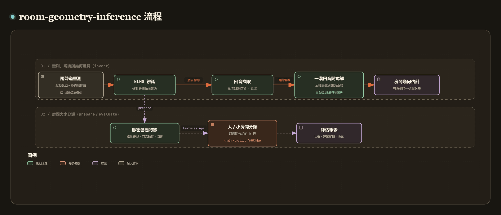

# room-geometry-inference

[](https://github.com/recklight/room-geometry-inference/actions/workflows/ci.yml)
[](https://www.python.org/downloads/)
[](LICENSE)

[English](README.md) | 繁體中文

從單一麥克風錄到的回音反推房間大小與聲源距離，主要用到鏡像源法（image-source method）與適應性濾波（adaptive filtering）。

量測檔是兩聲道 WAV：一個聲道是播放出去的激勵訊號，另一個是麥克風錄音。我先用 NLMS 適應性濾波器從這兩個聲道辨識出房間脈衝響應（room impulse response, RIR），取最強的幾個回音換算成距離，再依矩形房間的一階鏡像源模型，以閉式解反推房間長寬、聲源距離與麥克風位置。候選解不只一組，所以每一組都重新合成脈衝響應，跟辨識結果比對後排序。同一批脈衝響應也拿來訓練「大房間／小房間」分類器（以房間分組做交叉驗證）、比較去噪方法，另外對時間偏移、聲源方位角、聲源位置與雜訊做了敏感度分析。Python 套件叫 `room_geometry_inference`，命令列工具是 `room-geometry-inference`。

作者：RL

---

## 目錄

- [專案簡介](#專案簡介)
- [方法說明](#方法說明)
- [安裝步驟](#安裝步驟)
- [快速開始](#快速開始)
- [使用範例](#使用範例)
- [CLI 指令對照表](#cli-指令對照表)
- [專案結構](#專案結構)
- [資料準備](#資料準備)
- [設定檔](#設定檔)
- [結果與評估指標](#結果與評估指標)
- [已知限制](#已知限制)
- [設計重點](#設計重點)
- [開發與測試](#開發與測試)
- [References](#references)
- [License](#license)

---

## 專案簡介

[](https://raw.githack.com/recklight/room-geometry-inference/master/docs/workflow.zh-TW.html?theme=dark)

互動式流程圖：[線上瀏覽](https://raw.githack.com/recklight/room-geometry-inference/master/docs/workflow.zh-TW.html?theme=dark)，或在本機用瀏覽器開啟 [`docs/workflow.zh-TW.html`](docs/workflow.zh-TW.html)。可以縮放、搜尋節點，也能追蹤任兩個步驟之間的路徑。

房間的形狀藏在它的回音裡：直達聲之後，每一面牆的反射都比直達聲晚到一段時間，這段時間乘上聲速就是聲音多走的路。只要知道哪一個回音來自哪一面牆，就能把牆的位置推回來（Dokmanić et al., 2011；Dokmanić et al., 2013；Antonacci et al., 2012）。問題在於「哪一個回音來自哪一面牆」沒有寫在錄音裡，而且脈衝響應必須先從含雜訊的錄音中估計出來。另一條路線是不求精確幾何，直接從脈衝響應分類房間大小（Shabtai et al., 2010），或從語音估計房間體積（Genovese et al., 2019）。

這裡兩條路都做。幾何反解以閉式解處理回音指派（第 4 節）；房間的對稱性讓 8 個解完全等價，聲源方位角也無法由一階回音決定，這兩點在第 5 節說明。分類器以房間分組做交叉驗證，測試房間都是訓練時沒看過的。單聲道 WAV 讀取、UAR 與 sensitivity／specificity 用 [`speechdsp`](https://pypi.org/project/speechdsp/)，其餘步驟都在這個套件裡。

| 階段 | 做什麼 | 對應模組 |
| --- | --- | --- |
| 1. 模擬 | 鏡像源法合成二維與三維矩形房間的脈衝響應；激勵訊號、雜訊與兩聲道量測檔 | `image_source`、`excitation`、`recording` |
| 2. 辨識 | NLMS、LMS 或最小平方法由激勵與錄音估計脈衝響應，學習曲線與失準度 | `identification` |
| 3. 回音 | 峰值擷取（最小間距、距離衰減補償、次樣本內插）與距離換算 | `echoes` |
| 4. 反解 | 一階回音的閉式解、回音指派、對稱等價解去重、最小平方精修、重合成排序 | `inversion`、`geometry`、`room_estimation` |
| 5. 敏感度 | 到達時間偏移、聲源方位角、聲源位移與訊雜比的掃描 | `sensitivity` |
| 6. 特徵與分類 | 能量衰減曲線、回音到達時間、IMF 能量與脈衝響應振幅；SVM、KNN、決策樹與回音樣板比對 | `rir_features`、`emd`、`template_matching`、`models` |
| 7. 去噪 | 線性校正、PCA、MLP 與 PyTorch 深度去噪自編碼器的比較 | `denoising`、`autoencoder` |
| 8. 評估與輸出 | 以房間分組的分層 k 折交叉驗證、指標、圖表、執行資料夾與 `manifest.json` | `evaluation`、`figures`、`pipeline`、`manifest`、`cli` |
| 9. 合成資料 | 已知幾何的大／小房間兩聲道量測，供測試、範例與快速開始使用 | `synthetic` |

---

## 方法說明

### 1. 鏡像源法模擬房間脈衝響應

矩形房間中，牆面的鏡面反射等同於一整個晶格的「鏡像聲源」（Allen & Berkley, 1979）。沿著長度 $L$、聲源座標 $s$ 的一個軸，索引 $k \in \mathbb{Z}$ 的鏡像位於

$$x_k = (-1)^k s + \big(k + (k \bmod 2)\big) L ,$$

並在該軸上反射 $|k|$ 次：其中 $\lfloor (|k| + [k<0])/2 \rfloor$ 次在 $x=0$ 的牆，其餘在 $x=L$ 的牆。鏡像 $(k_x, k_y[, k_z])$ 到麥克風的距離為 $d$，聲音在 $\tau = d/c$ 抵達，振幅為

$$a = \frac{1}{d}\prod_w \beta_w^{\,n_w},$$

$n_w$ 是在牆 $w$ 反射的次數，$\beta_w$ 是該牆的反射係數。二維房間以真正的二維方式模擬（一階有 $3^2 = 9$ 個到達：直達聲、4 道牆面反射、4 道角落反射），不借用高度為 0 的三維房間，否則每個平面鏡像會被重複累加三次。到達時間可以四捨五入到整數樣本（恰好在兩個樣本中間時進位到較晚者），或以 Hann 窗的 sinc 函數保留次樣本延遲（Peterson, 1986）；聲速可直接給定，或由氣溫換算 $c = 331.3\sqrt{1 + T/273.15}$（Kinsler et al., 2000）。

| 設定鍵 | 預設 | 作用 |
| --- | --- | --- |
| `acoustics.sample_rate` | `16000` | 所有處理的取樣率（Hz）；其他取樣率的錄音會先重新取樣 |
| `acoustics.speed_of_sound_m_s` | `343.0` | 聲速（m/s）；`temperature_c` 有值時由氣溫換算 |
| `acoustics.temperature_c` | `null` | 氣溫（°C） |
| `acoustics.max_order` | `1` | 鏡像晶格的截斷階數 |
| `acoustics.order_mode` | `per_axis` | `per_axis`：每軸 $\lvert k_i \rvert \le N$；`total`：$\sum_i \lvert k_i \rvert \le N$ |
| `acoustics.reflection` | `1.0` | 牆面反射係數 |
| `acoustics.delay` | `integer` | `integer` 或 `fractional`（窗化 sinc） |
| `acoustics.rir_taps` | `1600` | 模擬脈衝響應的長度（16 kHz 下 100 ms） |

### 2. 由激勵與錄音辨識脈衝響應

喇叭播放已知的激勵 $x[n]$，麥克風錄到 $d[n] = (h * x)[n] + v[n]$。長度 $N$ 的 FIR 適應性濾波器 $\mathbf{w}$ 以回歸向量 $\mathbf{x}_n = (x[n], \dots, x[n-N+1])$ 逐樣本更新，收斂到 $h$（系統辨識，Haykin, 2014）。NLMS（Nagumo & Noda, 1967）為

$$e[n] = d[n] - \mathbf{w}_n^\top\mathbf{x}_n, \qquad \mathbf{w}_{n+1} = \mathbf{w}_n + \frac{\mu\, e[n]}{\varepsilon + \|\mathbf{x}_n\|^2}\,\mathbf{x}_n ,$$

正規化讓步長與激勵音量無關，$0 < \mu < 2$ 穩定。LMS（Widrow & Hoff, 1960）沒有正規化，步長必須小於 $2/(N\sigma_x^2)$，程式會先檢查，超出時直接報錯而不是發散。最小平方法則一步得到收斂解：以整段錄音估計自相關與互相關，用 Levinson 遞迴解 Toeplitz 正規方程。辨識結果只留最終權重，要看收斂過程時可以每隔若干樣本存一份快照；2 秒、16 kHz、1600 taps 的完整權重歷史有 5120 萬個 float64，約 410 MB，沒必要全部留下。學習曲線是最近 80 個樣本平方誤差的移動平均（dB），已知真實響應時另計正規化失準度 $20\log_{10}(\|h-\hat h\|/\|h\|)$。反解、`magnitude`／`imf_energy` 特徵與去噪比較使用取絕對值、除以峰值並把低於 `prune_threshold` 的 tap 設為 0 的響應；`decay_curve` 與 `echo_delays` 直接使用辨識出的權重。

| 設定鍵 | 預設 | 作用 |
| --- | --- | --- |
| `identification.method` | `nlms` | `nlms`、`lms` 或 `least_squares` |
| `identification.n_taps` | `1600` | 辨識的脈衝響應長度，必須涵蓋最遠的一階回音 |
| `identification.step` | `0.8` | 步長：NLMS 在 (0, 2)，LMS 必須小於穩定上限 |
| `identification.regularization` | `1e-10` | NLMS 分母的保護值；最小平方法的對角加載 |
| `identification.prune_threshold` | `0.001` | 低於峰值這個比例的 tap 設為 0 |

### 3. 回音擷取與距離換算

`peaks` 法以 `scipy.signal.find_peaks` 找出彼此至少相隔 `min_separation_taps` 的局部極大，捨棄低於最大值 `relative_height` 的峰，再保留最強的 `n_echoes` 個；`top_k` 法直接取最大的 `n_echoes` 個 tap，同一個被拉寬的回音可能佔掉好幾個名額，僅供對照。反射的振幅隨路徑長 $d$ 以 $1/d$ 衰減，而延遲與 $d$ 成正比，所以 `compensate_spreading` 以「振幅 × 延遲」排序，讓遠處的牆不會輸給近處的雜訊；門檻檢查仍用未加權的振幅，後段被放大的估計雜訊不會因此混進來。可選擇以三點拋物線把到達時間細化到次樣本。到達樣本 $t$（第 0 個樣本是發聲時刻）換算成距離 $d = tc/f_s$。

| 設定鍵 | 預設 | 作用 |
| --- | --- | --- |
| `echoes.n_echoes` | `9` | 保留的到達數（含直達聲） |
| `echoes.method` | `peaks` | `peaks` 或 `top_k` |
| `echoes.min_separation_taps` | `3` | 兩個峰的最小間距 |
| `echoes.relative_height` | `0.02` | 低於最大振幅這個比例的峰會被忽略 |
| `echoes.interpolate` | `false` | 以拋物線細化到次樣本 |
| `echoes.compensate_spreading` | `true` | 以振幅 × 延遲排序 |

### 4. 一階回音反解房間大小

平面房間 $[0,W]\times[0,D]$，麥克風在 $(m_x, m_y)$，聲源相對麥克風的位移為 $(a, b) = d_0(\cos\theta, \sin\theta)$，$d_0$ 是直達距離、$\theta$ 是聲源方位角。令 $u_x = 2m_x + a$、$v_x = 2W - 2m_x - a$（$u_y, v_y$ 同理），四道牆面反射的距離為

$$d_{x,\min}^2 = u_x^2 + b^2,\quad d_{x,\max}^2 = v_x^2 + b^2,\quad d_{y,\min}^2 = a^2 + u_y^2,\quad d_{y,\max}^2 = a^2 + v_y^2 ,$$

四道角落反射為 $\sqrt{u_x^2+u_y^2}$ 等四種組合。給定方位角時，四個方程彼此解耦，有閉式解

$$m_x = \tfrac12\Big(\sqrt{d_{x,\min}^2 - b^2} - a\Big),\qquad W = m_x + \tfrac12\Big(a + \sqrt{d_{x,\max}^2 - b^2}\Big),$$

$m_y, D$ 同理。每個平方根有正負兩個分支，共 $2^4 = 16$ 個代數解；因為 $u_x = m_x + s_x$ 是房間內兩個座標的和，只有正分支可能成立（`all_branches=True` 會把 16 個都算出來，由可行性檢查淘汰其餘 15 個）。

錄音不會標示哪個回音來自哪面牆。最早的到達視為直達聲，其餘 8 個回音中依序選 4 個指派給 (x_min, x_max, y_min, y_max)，共 $8!/4! = 1680$ 種，全部以陣列一次算完，淘汰房間、麥克風或聲源不合理的解。角落反射是超定的一致性檢查：每個預測的角落與最近的回音配對、每個沒被指派的回音與最近的預測角落配對，兩者的均方根誤差就是候選解的殘差（每一項最多計 0.5 m，一個多出來或漏掉的回音不會壓過其他全部吻合的解）。這就是「假設再驗證」的回音標記（Dokmanić et al., 2013）。之後再以 Levenberg–Marquardt 把房間、麥克風位置與聲源距離同時擬合到全部 9 個到達。偵測到的反射少於 8 個時，代表有到達重疊成同一個峰，此時允許同一個回音同時代表兩面牆。

| 設定鍵 | 預設 | 作用 |
| --- | --- | --- |
| `inversion.source_bearing_deg` | `45.0` | 假設的聲源方位角（見下一節） |
| `inversion.refine` | `true` | 以最小平方擬合全部 9 個到達 |
| `inversion.max_candidates` | `20` | 保留並重合成的相異候選解數 |

### 5. 對稱性與方位角的不可辨識性

**等價佈局。** 鏡像距離是每軸位移的斜邊，而沿長度 $L$ 的軸，鏡像位移的集合 $\{(s-m) + 2kL,\ -(s+m) + 2kL\}$ 在四種變換下不變：不變、鏡射（$m \to L-m$、$s \to L-s$）、交換聲源與麥克風在該軸的座標，以及鏡射加交換。兩軸各自套用，再加上 x、y 軸互換，共有 32 種佈局產生完全相同的脈衝響應（各牆反射係數相同時）。其中 8 種保持 45° 方位角，所以 45° 模型下永遠有 8 個同樣好的解。程式以「長邊為寬、座標字典序最小」的標準形去重，`n_equivalent` 記錄合併了幾個解；房間大小與聲源距離可以辨識，麥克風的絕對位置只能確定到這些對稱為止。尺寸誤差一律以排序後的邊長計算 $\sum_i|\hat L_{(i)} - L_{(i)}|$，不會因為長寬命名相反而被誤判，也不會讓正負誤差互相抵消。

**方位角無法由一階回音決定。** 每個角落距離都由兩面牆與直達聲決定：

$$d_{x,\min+y,\min}^2 = d_{x,\min}^2 + d_{y,\min}^2 - d_0^2 ,$$

其餘三個角落同理。角落只能檢查回音指派，完全不含 $\theta$ 的資訊：任何方位角都能以閉式解精確重現 9 個到達。因此一階到達只能把房間確定到一個單參數族

$$W(\theta) = \tfrac12\Big(\sqrt{d_{x,\min}^2 - b^2} + \sqrt{d_{x,\max}^2 - b^2}\Big),\qquad b = d_0\sin\theta ,$$

方位角必須已知或假設（預設 45°）。假設錯誤的代價是二階小量：$W \approx \tfrac12(d_{x,\min} + d_{x,\max}) - \tfrac{b^2}{4}(d_{x,\min}^{-1} + d_{x,\max}^{-1})$，聲源離麥克風越近、離牆越遠，影響越小。`bearing_family()` 會列出整個解族。

### 6. 候選解排序：重合成比對

每個候選佈局以同一組鏡像源設定重新合成脈衝響應，與觀測比對。預設的 `tap_match` 計算「預測到達附近 `tolerance_taps` 內沒有觀測回音」與「觀測回音附近沒有預測到達」兩者占全部到達的比例，對到達時間的取整誤差不敏感；平分時以殘差決定。另有逐樣本比較峰值正規化振幅的 `l1` 與 `l2`，但它們對一個樣本的偏移非常敏感：10 kHz 下小房間的取整到達會讓 `l1` 選錯房間，`tap_match` 則選對（測試中有這個案例）。

| 設定鍵 | 預設 | 作用 |
| --- | --- | --- |
| `inversion.rank_metric` | `tap_match` | `tap_match`、`l1` 或 `l2` |
| `inversion.tolerance_taps` | `2.0` | `tap_match` 的到達容許誤差（樣本） |

### 7. 敏感度分析

以 `room` 區段的場景為中心做四種掃描，每一列是一次估計，結果整理成表：

- `delay_offset`：所有到達加上同一個時間偏移（可為小數樣本），等同未補償的播放延遲；
- `source_bearing`：聲源以相同距離繞著麥克風移動，仍以假設的方位角反解，衡量 45° 假設錯誤的代價；
- `source_shift`：聲源沿 x 軸與 y 軸位移；
- `snr`：完整流程（模擬錄音 → NLMS → 回音擷取 → 反解 → 排序）在不同訊雜比下各做 `n_trials` 次。

雜訊以閉式增益 $g = \sqrt{P_s / (P_n 10^{\mathrm{SNR}/10})}$ 加入，量測到的訊雜比與設定值完全相同。`room_error_m` 是排序後邊長的絕對誤差和，`tap_shift` 是到達時間相對參考值的平均偏移（最佳配對後計算，漏掉或多出一個回音不會讓後面全部錯位）。

| 設定鍵 | 預設 | 作用 |
| --- | --- | --- |
| `sensitivity.sweeps` | 四種全部 | 要執行的掃描 |
| `sensitivity.delay_offsets_samples` | `[0, 0.2, 0.5, 1, 2, 5, 10, 30]` | 到達時間偏移（樣本） |
| `sensitivity.bearings_deg` | `[5, 15, …, 85]` | 真實聲源方位角 |
| `sensitivity.shifts_m` | `[-0.5, …, 0.5]` | 聲源沿 x、y 軸的位移 |
| `sensitivity.snr_db` | `[-5, 0, 5, 10, 20, 30]` | 訊雜比 |
| `sensitivity.n_trials` | `10` | 每個訊雜比重複的次數（每次使用不同的雜訊） |

### 8. 房間大小分類

每段量測辨識出的脈衝響應以四種方式描述，再交給分類器：

- `magnitude`：峰值正規化、低於門檻歸零的振幅（每個 tap 一個值）；
- `decay_curve`：Schroeder 反向積分能量衰減曲線（Schroeder, 1965），$E(t) = 10\log_{10}\big(\sum_{\tau \ge t} h^2(\tau) / \sum_\tau h^2(\tau)\big)$，下限 `floor_db`。曲線單調，回音位置稍微移動時曲線也只稍微移動，相近大小的房間會得到相近的曲線；
- `echo_delays`：最強 `n_echoes` 個回音的到達時間（ms）；
- `imf_energy`：經驗模態分解（EMD；Huang et al., 1998）各 IMF 的能量占比與過零率，以及殘量的能量占比。包絡以鏡射端點的三次樣條計算（Rilling et al., 2003），停止準則為相鄰候選的正規化平方差小於 `emd_tolerance`；另提供三門檻準則（Rilling et al., 2003）與固定篩選次數準則（Wu & Huang, 2009）。篩選次數與 IMF 數都設有上限，不會無窮迴圈。

分類器有 RBF 核心的支援向量機（Cortes & Vapnik, 1995）、k 近鄰（Cover & Hart, 1967；鄰居的票以距離倒數加權）、CART 決策樹（Breiman et al., 1984），以及回音樣板比對：保存每筆訓練響應的回音到達型態，新響應的回音落在樣板回音 `template_tolerance_taps` 以內的比例就是比對分數。`predict` 時最佳分數低於 `template_min_score` 就回答 `unknown`，這類量測可以直接交給 `invert` 反解；`evaluate` 的交叉驗證一律取最佳類別。標準化等需要從資料學參數的步驟都包在 scikit-learn（Pedregosa et al., 2011）的 `Pipeline` 裡，只在訓練折上擬合。評估採分層、以房間分組的 k 折交叉驗證（Kohavi, 1995），主要指標為 UAR（Schuller et al., 2009），兩類時另計 sensitivity、specificity 與 ROC-AUC（Fawcett, 2006）。`prepare --svmlight` 可另外把特徵匯出成 LIBSVM 稀疏文字格式（Chang & Lin, 2011），供其他工具使用。

| 設定鍵 | 預設 | 作用 |
| --- | --- | --- |
| `features.representation` | `decay_curve` | `magnitude`、`decay_curve`、`echo_delays` 或 `imf_energy` |
| `features.floor_db` | `-60.0` | 衰減曲線的下限（dB） |
| `features.max_imfs` | `6` | `imf_energy` 描述的 IMF 數 |
| `features.emd_tolerance` | `0.3` | EMD 篩選的停止門檻 |
| `model.name` | `svm` | `svm`、`knn`、`tree` 或 `template`（`template` 需要 `magnitude`） |
| `model.svm_c` | `10.0` | SVM 的懲罰參數 |
| `model.svm_gamma` | `scale` | RBF 核心寬度：`scale`、`auto` 或正數 |
| `model.n_neighbors` | `5` | KNN 的鄰居數 |
| `model.tree_max_depth` | `null` | 決策樹深度上限；`null` 不限制 |
| `model.template_tolerance_taps` | `2.0` | 樣板比對的到達容許誤差 |
| `model.template_min_score` | `0.7` | 低於此比對分數回答 `unknown`（僅 `predict`；`evaluate` 一律取最佳類別） |

### 9. 脈衝響應去噪

辨識出的 $|\hat h|$ 有一層估計雜訊，真實的 $h$ 則只有幾個回音、其餘為 0。去噪器學習從前者到後者的對應，以每筆響應的 $\mathrm{MSE_{dB}} = 10\log_{10}\frac1N\sum_t (h[t] - \tilde h[t])^2$ 評分。候選方法：`identity`（不處理，所有方法都必須贏過它）、`linear`（全部 tap 共用一個增益與偏移的最小平方校正）、`pca`（投影到乾淨訓練響應的主成分子空間；Pearson, 1901）、`mlp`（scikit-learn 多層感知器，輸入與目標逐 tap 標準化，即去噪自編碼器；Vincent et al., 2008；Lu et al., 2013），以及 `deep_autoencoder`（同樣概念的 PyTorch 版本，以 Adam 訓練（Kingma & Ba, 2015），標準化參數存成網路的 buffer；`denoising.device=cuda` 時在 GPU 上訓練較大的網路）。所有方法用同一組以房間分組的 k 折切分，每個房間都由沒看過它的模型去噪；只會記住訓練房間的查表在這裡會失敗。

| 設定鍵 | 預設 | 作用 |
| --- | --- | --- |
| `denoising.methods` | `[identity, linear, pca, mlp]` | 要比較的方法；`deep_autoencoder` 需要 `dl` extra |
| `denoising.architectures` | `[[300, 300, 300]]` | 隱藏層寬度；每個網路方法對每種架構各評估一次 |
| `denoising.activation` | `logistic` | `logistic`、`relu` 或 `tanh` |
| `denoising.n_epochs` | `300` | 訓練回合數 |
| `denoising.learning_rate` | `0.001` | Adam 步長 |
| `denoising.batch_size` | `32` | 小批次大小 |
| `denoising.weight_decay` | `0.0001` | L2 懲罰 |
| `denoising.n_components` | `10` | `pca` 保留的主成分數 |
| `denoising.device` | `cpu` | `cpu` 或 `cuda`（`deep_autoencoder`） |

### 10. 合成資料

`synthesize` 指令與測試使用的合成資料由 `synthetic` 區段控制。每個類別是一個名義房間大小（預設 `large` 10.7 × 7.5 m 與 `small` 3.5 × 3.0 m）；每類產生 `n_rooms_per_class` 個不同的房間，邊長在名義值 ± `room_jitter_m` 內均勻抽樣；每個房間量測 `n_recordings_per_room` 次，每次重新擺放麥克風與聲源：直達距離在 `source_distance_range_m` 內抽樣，聲源位於麥克風的 `source_bearing_deg` 方向，兩者離牆至少 `wall_margin_m`。每次量測以 `excitation` 激勵（預設白雜訊，另有粉紅雜訊、類語音、多人交談聲與純音）經過該房間的鏡像源脈衝響應，再加上 `snr_db` 的雜訊，寫成兩聲道 16 位元 WAV。幾何在模擬前先四捨五入到公釐，寫進 `dataset.csv` 的值就是模擬用的值；房間即為 `group`。

同一類的房間彼此不同，同一個房間每次量測的位置也不同，所以分類器要能推廣到沒看過的房間才拿得到分數。量測格式與真實資料完全相同，又有幾何真值，`invert` 與 `denoise` 可以直接計算誤差。同一個種子會寫出逐位元組相同的檔案。

| 設定鍵 | 預設 | 作用 |
| --- | --- | --- |
| `synthetic.class_names` | `[large, small]` | 類別名稱，與 `room_sizes_m` 一一對應 |
| `synthetic.room_sizes_m` | `[[10.7, 7.5], [3.5, 3.0]]` | 各類的名義 `[寬, 深]`（m） |
| `synthetic.room_jitter_m` | `0.3` | 邊長的抽樣範圍 |
| `synthetic.n_rooms_per_class` | `8` | 每類的房間數（交叉驗證的分組） |
| `synthetic.n_recordings_per_room` | `3` | 每個房間的量測次數 |
| `synthetic.source_distance_range_m` | `[0.8, 1.6]` | 直達距離範圍 |
| `synthetic.source_bearing_deg` | `45.0` | 聲源方位角 |
| `synthetic.wall_margin_m` | `0.3` | 離牆最小距離 |
| `synthetic.excitation` | `white` | `white`、`pink`、`speech_like`、`babble` 或 `sine` |
| `synthetic.duration_s` | `2.0` | 每段量測的長度（秒） |
| `synthetic.snr_db` | `30.0` | 麥克風端的訊雜比；`null` 不加雜訊 |
| `synthetic.noise` | `white` | `white`、`pink`、`babble` 或 `sine` |

`simulate` 與 `sensitivity` 的單一場景由 `room` 區段指定（預設 10.7 × 7.5 m，麥克風在中心 (5.35, 3.75)，聲源在 (6.35, 4.75)），激勵、長度與雜訊沿用 `synthetic` 區段。

---

## 安裝步驟

需要 Python 3.10 以上。

```bash
git clone https://github.com/recklight/room-geometry-inference.git
cd room-geometry-inference
python -m venv .venv
# Windows: .venv\Scripts\activate    Linux/macOS: source .venv/bin/activate
pip install -e .                 # 核心（會一併從 PyPI 安裝 speechdsp）
pip install -e ".[dl]"           # PyTorch 模型（選用）
pip install -e ".[dev]"          # 開發工具：pytest、ruff
```

沒有安裝 `dl` extra 時，除了 `deep_autoencoder` 去噪器以外的所有功能（模擬、辨識、反解、敏感度分析、分類、其他去噪器、圖表）都能使用；要求 `deep_autoencoder` 時，錯誤訊息會提示在專案資料夾執行 `pip install -e ".[dl]"`。也可以不安裝，直接在專案資料夾內以 `PYTHONPATH=src python -m room_geometry_inference --help` 執行。

---

## 快速開始

不需要任何資料，以下指令會先產生合成資料集。

```bash
# 1. 產生合成資料集
room-geometry-inference synthesize --config configs/quick_demo.yaml --out data/synthetic
# 2. 由資料集索引準備模型輸入
room-geometry-inference prepare --config configs/quick_demo.yaml --out outputs/demo/prepare
# 3. 交叉驗證
room-geometry-inference evaluate outputs/demo/prepare/features.npz --config configs/quick_demo.yaml --out outputs/demo/evaluate
# 4. 以全部資料訓練
room-geometry-inference train outputs/demo/prepare/features.npz --config configs/quick_demo.yaml --out outputs/demo/train
# 5. 對新的輸入檔推論
room-geometry-inference predict data/synthetic/small/small_000.wav --model outputs/demo/train/model.joblib --out outputs/demo/predict
```

或一次跑完整個流程：`python examples/end_to_end_synthetic.py`。房間幾何反解的展示：`room-geometry-inference simulate --out outputs/demo/simulate`。

> 快速開始的 UAR 是 1.000（見「結果與評估指標」），但合成量測是 `acoustics.max_order: 1` 的平面房間，每段只有 9 個到達，沒有地板、天花板、家具與更高階的反射，所以這只代表流程跑得通，不代表真實房間也分得這麼準。

---

## 使用範例

### CLI

```bash
# 1. 由 <資料夾>/<類別>/<檔案>.wav 的結構產生資料集索引，再把 group 欄改成房間代號
room-geometry-inference index data/rooms
# 2. 辨識每段量測的脈衝響應並計算能量衰減曲線（量測若是 48 kHz 會先重新取樣）
room-geometry-inference prepare --dataset data/rooms/dataset.csv --set identification.n_taps=2400 --out outputs/rooms/prepare
# 3. 以房間分組的 5 折交叉驗證；特徵設定必須與 prepare 相同
room-geometry-inference evaluate outputs/rooms/prepare/features.npz --set identification.n_taps=2400 --seed 1 --out outputs/rooms/evaluate
# 4. 以全部資料訓練並存檔，再推論新的量測
room-geometry-inference train outputs/rooms/prepare/features.npz --set identification.n_taps=2400 --out outputs/rooms/train
room-geometry-inference predict new/take_01.wav --model outputs/rooms/train/model.joblib --out outputs/rooms/predict
# 5. 直接反解每段量測的房間大小與聲源距離（dataset.csv 有幾何欄時會一併計算誤差）
room-geometry-inference invert --dataset data/rooms/dataset.csv --set identification.n_taps=2400 --out outputs/rooms/invert
# 6. 室溫 26 °C、聲源在麥克風正右方（方位角 0°）
room-geometry-inference invert new/take_01.wav --set acoustics.temperature_c=26 --set inversion.source_bearing_deg=0 --out outputs/rooms/invert_one
```

固定不變的設定我會寫進自己的 YAML（例如 `configs/my_rooms.yaml`，只列與預設不同的鍵；`configs/my_*.yaml` 不進版控），再用 `--config` 指定，省得每個指令都重複 `--set`。`--set` 的值以 JSON 解讀，清單要寫成 `--set 'denoising.methods=["identity","pca"]'`。

### Python API

```python
import numpy as np

from room_geometry_inference import (
    Config,
    bearing_family,
    best_estimate,
    cross_validate,
    first_order_distances,
    image_source_rir,
    invert_echoes,
    prepare_features,
    simulate_scene,
    write_synthetic_dataset,
)

# 1. 低階函式：10.7 x 7.5 m 房間的一階脈衝響應，9 個到達樣本（16 kHz）
result = image_source_rir([10.7, 7.5], [6.35, 4.75], [5.35, 3.75], sample_rate=16_000)
print(result.arrival_taps())  # [ 66 307 399 455 545 548 602 624 675]

# 2. 由精確的回音距離反解：房間、聲源距離與 8 個等價解
distances = first_order_distances(10.7, 7.5, 5.35, 3.75, 1.0, 1.0)
estimate = best_estimate(invert_echoes(distances))
print([round(side, 3) for side in estimate.size_m], round(estimate.source_distance_m, 3), estimate.n_equivalent)  # [10.7, 7.5] 1.414 8

# 3. 方位角不可辨識：每個方位角都能精確重現 9 個到達，只是房間略有不同
family = bearing_family(distances, bearings_deg=[15.0, 45.0, 75.0])
print(family["width_m"].round(3).tolist())  # [10.741, 10.7, 10.659]

# 4. 完整流程：模擬錄音 → NLMS → 回音 → 反解
config = Config()
scene = simulate_scene(config, rng=0)
print([round(side, 3) for side in scene.inversion.estimate.size_m], round(scene.misalignment_db, 1))  # [10.704, 7.501] -31.9

# 5. 合成資料 → 衰減曲線 → 以房間分組的交叉驗證
config = Config.from_yaml("configs/quick_demo.yaml")
index = write_synthetic_dataset("data/synthetic", config.synthetic, rng=config.seed)
features = prepare_features(index, config)
uar = cross_validate(features, config).metrics["summary"]["uar"]
print(f"{uar['mean']:.3f} +/- {uar['std']:.3f}")  # 1.000 +/- 0.000
```

### 範例腳本

| 腳本 | 示範什麼 | 執行時間 |
| --- | --- | --- |
| `examples/end_to_end_synthetic.py` | 合成資料 → 衰減曲線 → 以房間分組的交叉驗證 → 訓練存檔 → 讀回推論，全部經由公開 API | 約 7 秒（`--quick` 約 3 秒） |
| `examples/invert_simulated_room.py` | 大、小兩個參考房間的模擬、辨識與反解，以及大房間的方位角解族 | 約 2 秒（`--quick` 約 2 秒） |
| `examples/sweep_inversion_sensitivity.py` | 時間偏移、方位角、聲源位移與訊雜比四種掃描，表格與誤差棒圖 | 約 11 秒（`--quick` 約 3 秒） |
| `examples/compare_rir_denoisers.py` | 5 dB 訊雜比下以房間分組比較去噪器；裝了 PyTorch 時加入深度自編碼器（`--quick` 不含） | 約 33 秒（`--quick` 約 4 秒） |
| `examples/compare_feature_representations.py` | 四種特徵 × 各分類器在沒看過的房間上的 UAR 比較表與長條圖 | 約 9 秒（`--quick` 約 5 秒） |

每支腳本都接受 `--out`、`--seed` 與 `--quick`，預設輸出到 `examples/output/<腳本名稱>/`。

---

## CLI 指令對照表

| 指令 | 用途 | 主要輸入 | 主要輸出 |
| --- | --- | --- | --- |
| `synthesize` | 寫出已知幾何、與真實資料相同格式的合成量測 | 設定 | `<out>/<類別>/<類別>_<NNN>.wav`、`dataset.csv` |
| `index` | 由 `<資料夾>/<類別>/<檔案>.wav` 產生資料集索引 | 資料夾 | `<資料夾>/dataset.csv` |
| `prepare` | 辨識每段量測的脈衝響應並計算特徵 | `dataset.csv` | `features.npz`、`items.csv`（`--svmlight` 另出 `features.svm`） |
| `evaluate` | 以房間分組的分層 k 折交叉驗證 | `features.npz` | `metrics.json`、`folds.csv`、`predictions.csv`、混淆矩陣與 ROC 圖表 |
| `train` | 以全部量測訓練一次並存檔 | `features.npz` | `model.joblib` |
| `predict` | 以模型檔推論新的量測，只用模型檔裡的設定 | WAV 檔、模型檔 | `predictions.csv` |
| `simulate` | 模擬 `room` 場景、辨識脈衝響應並反解房間 | 設定（可選 `--excitation` 單聲道 WAV） | `images.csv`、`recording.wav`、`impulse_response.*`、`learning_curve.*`、`candidates.csv`、`estimate.json` |
| `invert` | 由量測反解房間大小與聲源距離 | WAV 檔或 `dataset.csv` | `estimates.csv`；有幾何真值時加 `room_estimates.*` |
| `sensitivity` | 時間偏移、方位角、聲源位移與訊雜比掃描 | 設定 | `sensitivity.csv`、`sensitivity_summary.csv`、`sensitivity_<掃描>.*` |
| `denoise` | 以房間分組的交叉驗證比較脈衝響應去噪器 | 有幾何欄的 `dataset.csv` | `denoising_scores.*`、`denoising_summary.csv` |

| 選項 | 適用指令 | 說明 |
| --- | --- | --- |
| `--log-level LEVEL` | 全域（寫在子命令之前） | `DEBUG`、`INFO`（預設）、`WARNING` 或 `ERROR`；記錄輸出到 stderr |
| `--version` | 全域 | 顯示版本後結束 |
| `--config/-c PATH` | 除了 `index`、`predict` 以外的所有指令 | YAML 設定檔；沒給時使用預設值 |
| `--set/-s KEY=VALUE` | 同上 | 覆寫一個設定，例如 `--set model.name=knn`；值以 JSON 解讀，可重複 |
| `--seed INT` | `synthesize`、`evaluate`、`train`、`simulate`、`sensitivity`、`denoise` | 等同 `--set seed=INT` |
| `--dataset/-d PATH` | `prepare`、`invert`、`denoise` | 等同 `--set data.dataset=PATH` |
| `--out/-o PATH` | `index` 以外所有會寫檔的指令 | 輸出資料夾；沒給時在 `output.root` 底下建立 `<指令>_<UTC 時間>`（`synthesize` 預設為 `data/synthetic`） |
| `--model/-m PATH` | `predict` | `train` 寫出的模型檔（必填） |
| `--svmlight/--no-svmlight` | `prepare` | 是否另外匯出 LIBSVM 稀疏文字格式（預設不匯出） |
| `--excitation PATH` | `simulate` | 用這個單聲道 WAV 當激勵，不另外合成 |
| `--force` | `index` | 覆寫已存在的 `dataset.csv`；沒加時保留原檔並報錯，手動改過的 `group` 與幾何欄不會被蓋掉 |

exit code：`0` 表示成功；`2` 表示輸入或設定有誤（只印一行 `error: ...`，加上 `--log-level DEBUG` 可看到完整的 traceback）；`1` 表示被中斷或程式本身的錯誤。

---

## 專案結構

```text
room-geometry-inference/
├── .github/
│   ├── ISSUE_TEMPLATE/
│   │   ├── bug_report.yml               # 錯誤回報表單
│   │   ├── config.yml                   # 停用空白 issue
│   │   └── feature_request.yml          # 功能建議表單
│   └── workflows/
│       └── ci.yml                       # lint、3.10 語法閘門、Linux／Windows × Python 3.10–3.13、最舊相依版本、PyTorch
├── configs/
│   ├── default.yaml                     # 與 Config() 完全相同，逐鍵附註解
│   ├── quick_demo.yaml                  # 小型合成資料，幾秒內跑完
│   └── similar_rooms.yaml               # 深度相近、長度不同的兩類房間（較難的分類）
├── data/
│   └── .gitkeep                         # 資料的預設位置，內容不進版控
├── outputs/
│   └── .gitkeep                         # 執行資料夾的預設根目錄，內容不進版控
├── docs/
│   ├── images/workflow.png              # 英文版流程圖（README.md）
│   ├── images/workflow.zh-TW.png        # 本 README 的流程圖
│   ├── workflow.html                    # 英文版互動式流程圖
│   └── workflow.zh-TW.html              # 互動式流程圖（瀏覽器開啟）
├── examples/
│   ├── end_to_end_synthetic.py          # 端到端流程
│   ├── invert_simulated_room.py         # 參考房間的反解與方位角解族
│   ├── sweep_inversion_sensitivity.py   # 四種敏感度掃描
│   ├── compare_rir_denoisers.py         # 去噪器比較
│   └── compare_feature_representations.py  # 特徵 × 分類器比較
├── src/
│   └── room_geometry_inference/
│       ├── __init__.py                  # 公開 API
│       ├── __main__.py                  # python -m room_geometry_inference
│       ├── py.typed                     # 型別資訊標記
│       ├── cli.py                       # typer 命令列
│       ├── config.py                    # 設定 dataclass 與 YAML 讀寫
│       ├── errors.py                    # 例外類別
│       ├── logging_utils.py             # logging 設定
│       ├── manifest.py                  # 執行資料夾與 manifest.json
│       ├── dataset.py                   # dataset.csv、features.npz 與 LIBSVM 匯出
│       ├── synthetic.py                 # 已知幾何的合成量測
│       ├── image_source.py              # 鏡像源法脈衝響應模擬
│       ├── excitation.py                # 激勵與干擾訊號
│       ├── recording.py                 # 迴響、精確訊雜比的雜訊、兩聲道 WAV
│       ├── identification.py            # NLMS、LMS、最小平方辨識，學習曲線與失準度
│       ├── echoes.py                    # 回音擷取與距離換算
│       ├── geometry.py                  # 等價佈局與尺寸誤差
│       ├── inversion.py                 # 閉式解、回音指派、精修、排序、方位角解族
│       ├── room_estimation.py           # 從錄音到房間估計的完整流程
│       ├── sensitivity.py               # 敏感度掃描
│       ├── emd.py                       # 經驗模態分解
│       ├── rir_features.py              # 脈衝響應的四種特徵
│       ├── template_matching.py         # 回音樣板比對
│       ├── denoising.py                 # 去噪器與其比較
│       ├── autoencoder.py               # PyTorch 深度去噪自編碼器（延遲匯入）
│       ├── models.py                    # 分類器註冊表與模型檔
│       ├── pipeline.py                  # prepare／train／predict／invert／denoise 高階函式
│       ├── evaluation.py                # 分組交叉驗證與指標
│       └── figures.py                   # 圖表與對應表格
├── tests/                               # 各模組的 test_<module>.py，另有範例、3.10 相容性與文件的檢查
├── .gitattributes
├── .gitignore
├── CHANGELOG.md
├── CITATION.cff
├── CONTRIBUTING.md
├── LICENSE
├── README.md
├── README.zh-TW.md
└── pyproject.toml
```

---

## 資料準備

專案裡沒有附任何量測。自己的兩聲道量測可以放在 `data/` 底下（不進版控）或專案以外的位置，再把 `data.dataset`（或 `--dataset`）指向它的 `dataset.csv`；手上還沒有量測時，`synthesize` 會寫出格式完全相同的合成資料。

### 1. 資料集索引 dataset.csv

| 欄位 | 必要 | 說明 |
| --- | --- | --- |
| `path` | 是 | 量測 WAV 檔路徑，相對於 `dataset.csv` 所在的資料夾，以 `/` 分隔（`\` 也接受） |
| `label` | 分類時必要 | 房間類別，例如 `large`、`small`；`invert` 與 `denoise` 不需要 |
| `group` | 否 | 房間代號。同一個房間的所有量測一定在同一折；沒有這一欄時每段量測自成一組 |
| `room_width_m`、`room_depth_m`、`mic_x_m`、`mic_y_m`、`source_x_m`、`source_y_m` | 否（要就六欄全給） | 真實平面幾何（m），房間範圍為 `[0, 寬] × [0, 深]`；`invert` 用來計算誤差，`denoise` 用來模擬乾淨的目標響應 |

```csv
path,label,group,room_width_m,room_depth_m,mic_x_m,mic_y_m,source_x_m,source_y_m
large/take_001.wav,large,lecture_hall,10.7,7.5,5.35,3.75,6.35,4.75
large/take_002.wav,large,lecture_hall,10.7,7.5,3.10,2.20,4.10,3.20
small/take_001.wav,small,office_3f,3.5,3.0,1.75,1.50,2.75,2.50
```

檔名不承載任何意義，標籤、分組與幾何只從欄位讀取。若量測已經依類別放在子資料夾，`room-geometry-inference index <資料夾>` 會寫出一份 `dataset.csv`（每段量測一組），再把 `group` 改成房間代號即可。資料夾裡已經有 `dataset.csv` 時，`index` 不會覆寫它，要重建請加 `--force`。索引列出的檔案若不存在，程式會列出前 5 個找不到的路徑並停止。

### 2. 量測檔格式

| 項目 | 要求與處理方式 |
| --- | --- |
| 容器 | RIFF／WAVE；8、16、32 位元整數或浮點 PCM 都可以 |
| 聲道 | **兩個聲道**：聲道 0 是送到喇叭的激勵（最好是音效卡迴授錄下的訊號，播放延遲才會互相抵消），聲道 1 是麥克風；單聲道檔會被拒絕並說明原因 |
| 取樣率 | 任意；兩個聲道一律以多相濾波器重新取樣到 `acoustics.sample_rate`（預設 16 kHz） |
| 長度 | 必須長於 `identification.n_taps`；白雜訊激勵建議至少 1–2 秒，類語音激勵收斂慢，需要更長 |
| 激勵 | 白雜訊或粉紅雜訊最理想；純音只激發一個頻率，無法辨識整個脈衝響應 |
| 響應長度 | `identification.n_taps / sample_rate × c` 必須大於最遠的一階回音路徑（約為房間對角線的兩倍）；預設 1600 taps 在 16 kHz 下涵蓋約 34 m |

兩個聲道必須同步取樣：兩聲道之間若有固定延遲，每個回音都會跟著偏移，房間大小隨之偏差（見「結果與評估指標」的時間偏移掃描：1 個樣本約 3.4 cm）。

### 3. 量測場景的假設

反解採用平面矩形房間的一階模型：只用四面牆與四個角落的第一次與第二次反射，房間高度不參與；聲源方位角（從麥克風看聲源的方向）必須已知或假設（預設 45°，即聲源在麥克風的右前方、與牆面成 45°）。實際量測時建議讓聲源與麥克風同高、離地板與天花板都有一段距離，並記下聲源的方位角，以 `--set inversion.source_bearing_deg=...` 指定。

---

## 設定檔

- `configs/default.yaml`：與 `Config()` 完全相同，每個鍵都附英文註解，適合複製後修改。
- `configs/quick_demo.yaml`：只列與預設不同的鍵（小型合成資料、較少的掃描點、4 折），讓「快速開始」幾秒內跑完；`data.dataset` 指向 `data/synthetic/dataset.csv`。
- `configs/similar_rooms.yaml`：兩類深度相近、長度相差約 2.8 m 的房間（10.7 × 7.5 m 與 7.9 × 7.6 m），分類比預設困難。

程式不會自動載入任何設定檔：沒給 `--config` 時使用預設值。設定裡的相對路徑以目前的工作目錄為基準。

| 區段 | 重要欄位 | 說明 |
| --- | --- | --- |
| （頂層） | `seed` | 主種子 |
| `data` | `dataset` | 資料集索引（預設為佔位值 `data/dataset.csv`） |
| `synthetic` | `class_names`、`room_sizes_m`、`n_rooms_per_class`、`n_recordings_per_room`、`excitation`、`duration_s`、`snr_db`、`noise` | 合成資料，以及 `simulate`／`sensitivity` 的激勵與雜訊 |
| `acoustics` | `sample_rate`、`speed_of_sound_m_s`、`temperature_c`、`max_order`、`order_mode`、`reflection`、`delay`、`rir_taps` | 取樣率與鏡像源模型，模擬、距離換算與重合成共用 |
| `room` | `size_m`、`microphone_m`、`source_m` | `simulate` 與 `sensitivity` 的場景 |
| `identification` | `method`、`n_taps`、`step`、`regularization`、`prune_threshold` | 脈衝響應辨識 |
| `echoes` | `n_echoes`、`method`、`min_separation_taps`、`relative_height`、`interpolate`、`compensate_spreading` | 回音擷取 |
| `inversion` | `source_bearing_deg`、`rank_metric`、`tolerance_taps`、`refine`、`max_candidates` | 反解與排序 |
| `sensitivity` | `sweeps`、`delay_offsets_samples`、`bearings_deg`、`shifts_m`、`snr_db`、`n_trials` | 敏感度掃描 |
| `denoising` | `methods`、`architectures`、`activation`、`n_epochs`、`learning_rate`、`batch_size`、`device` | 去噪器比較 |
| `features` | `representation`、`floor_db`、`max_imfs`、`emd_tolerance` | 分類特徵 |
| `model` | `name`、`svm_c`、`svm_gamma`、`n_neighbors`、`tree_max_depth`、`template_tolerance_taps`、`template_min_score` | 分類器 |
| `evaluation` | `n_splits`、`positive_class` | 交叉驗證折數與陽性類別 |
| `output` | `root`、`figure_format`、`dpi` | 執行資料夾的位置與圖檔格式 |

`acoustics`、`identification`、`echoes` 與 `features` 決定 `prepare` 的輸出，會存進 `features.npz`；`evaluate` 與 `train` 讀入時若這些區段與目前的設定不同，會直接報錯，避免拿不同設定的特徵訓練。`predict` 只使用模型檔裡的設定。

未知的鍵會直接報錯，並列出合法的鍵，例如：

```text
$ room-geometry-inference prepare --set echoes.n_echo=9
error: unknown configuration key 'echoes.n_echo'; valid keys here are ['compensate_spreading', 'interpolate', 'method', 'min_separation_taps', 'n_echoes', 'relative_height']
```

---

## 結果與評估指標

一次 `evaluate` 的執行資料夾：

```text
outputs/demo/evaluate/
├── config.yaml                # 實際使用的完整設定
├── manifest.json              # 指令、時間、版本、輸入檔的 SHA-256、種子
├── metrics.json               # 每折、摘要與合併後的指標
├── folds.csv                  # 每折一列
├── predictions.csv            # 每段量測一筆 out-of-fold 預測
├── confusion_matrix.png       # 合併的混淆矩陣
├── confusion_matrix.csv       # 同一張圖的數字
├── roc_curve.png              # 陽性類別的 ROC 曲線（兩類時）
└── roc_curve.csv
```

| 檔案 | 內容 |
| --- | --- |
| `metrics.json` | `task`、`n_items`、`n_splits`、`seed`、`folds`、`summary`（每個指標的 `mean` 與 `std`）、`pooled`（含 `classes`、`confusion_matrix`、`per_class`） |
| `folds.csv` | `fold`、`n_train`、`n_test`、`uar`、`accuracy`、`f1_macro`、`sensitivity`、`specificity`、`roc_auc` |
| `predictions.csv` | `path`、`group`、`fold`、`label`、`predicted`、`score_<類別>`，列順序與 `items.csv` 相同 |
| `confusion_matrix.csv` | `label`（真實類別）、`predicted`、`count`、`fraction`（占該真實類別的比例） |
| `roc_curve.csv` | `false_positive_rate`、`true_positive_rate`、`threshold` |

`invert` 的 `estimates.csv` 每段量測一列：`status`（`ok` 或 `no_solution`）、偵測到的回音數、估計的寬、深、聲源距離、麥克風與聲源位置（等價解之一）、殘差、排序分數與等價解數；有幾何真值時再加 `true_width_m`、`true_depth_m`、`true_source_distance_m`、`room_error_m`、`distance_error_m`。

| 指標 | 定義 | 為什麼看它 |
| --- | --- | --- |
| UAR | 各類召回率的平均 | 類別不平衡時的主要指標；一律猜同一類只會得到 0.5 |
| accuracy | 預測正確的比例 | 直觀，但會被多數類別主導 |
| `f1_macro` | 各類 F1 的平均 | 同時反映 precision 與 recall |
| sensitivity／specificity | 陽性類別（`evaluation.positive_class`）的召回率／陰性類別的召回率 | 兩類錯誤分開看 |
| `roc_auc` | 陽性類別分數的 ROC 曲線下面積 | 不依賴決策門檻；測試折只有一類時記為 `null` |
| `room_error_m` | 排序後邊長的絕對誤差和 $\sum_i \lvert \hat L_{(i)} - L_{(i)} \rvert$ | 長寬命名相反不算錯，正負誤差也不會抵消 |
| `distance_error_m` | 聲源距離的絕對誤差 | 直達聲換算的準確度 |
| `misalignment_db` | $20\log_{10}(\lVert h-\hat h\rVert / \lVert h\rVert)$ | 辨識出的脈衝響應有多接近真實響應 |
| `mse_db` | 每筆響應的 $10\log_{10}$ 均方誤差 | 去噪效果，與不處理的 `identity` 比較 |

下面各小節的數字，都是我在合成資料上執行該節指令的輸出（Windows 11、Python 3.13、scikit-learn 1.7、NumPy 2.3、PyTorch 2.14 CPU），寫成平均 ± 樣本標準差（`ddof=1`）。換作業系統或套件版本，最後幾位可能略有不同。

### 快速開始的結果

`quick_demo.yaml`：8 個房間、16 段 1 秒的量測，衰減曲線 + SVM，4 折。

```bash
room-geometry-inference synthesize --config configs/quick_demo.yaml --out data/synthetic
room-geometry-inference prepare --config configs/quick_demo.yaml --out outputs/demo/prepare
room-geometry-inference evaluate outputs/demo/prepare/features.npz --config configs/quick_demo.yaml --out outputs/demo/evaluate
```

| 筆數 | UAR | accuracy | macro F1 | sensitivity | specificity | ROC-AUC |
| --- | --- | --- | --- | --- | --- | --- |
| 16 | 1.000 ± 0.000 | 1.000 ± 0.000 | 1.000 ± 0.000 | 1.000 ± 0.000 | 1.000 ± 0.000 | 1.000 ± 0.000 |

| 真實＼預測 | large | small |
| --- | --- | --- |
| large | 8 | 0 |
| small | 0 | 8 |

### 哪種特徵能推廣到沒看過的房間

預設大小的合成資料：16 個房間、48 段 2 秒的量測，5 折、以房間分組。表中數值為 UAR。

```bash
room-geometry-inference synthesize --out data/synthetic_full
for representation in magnitude decay_curve echo_delays imf_energy; do
  room-geometry-inference prepare --dataset data/synthetic_full/dataset.csv --set features.representation=$representation --out outputs/full/$representation
  for model in svm knn tree; do
    room-geometry-inference evaluate outputs/full/$representation/features.npz --set features.representation=$representation --set model.name=$model --out outputs/full/$representation-$model
  done
done
room-geometry-inference evaluate outputs/full/magnitude/features.npz --set features.representation=magnitude --set model.name=template --out outputs/full/magnitude-template
```

| 特徵 | SVM | KNN | 決策樹 | 回音樣板 |
| --- | --- | --- | --- | --- |
| `magnitude` | 0.500 ± 0.000 | 0.550 ± 0.201 | 0.667 ± 0.083 | 0.867 ± 0.126 |
| `decay_curve` | 1.000 ± 0.000 | 1.000 ± 0.000 | 1.000 ± 0.000 | — |
| `echo_delays` | 0.967 ± 0.075 | 0.967 ± 0.075 | 1.000 ± 0.000 | — |
| `imf_energy` | 0.883 ± 0.075 | 0.883 ± 0.112 | 0.717 ± 0.192 | — |

直接把脈衝響應振幅交給分類器，在沒看過的房間上幾乎是亂猜：SVM 把 48 段量測全部判成 `small`，因為稀疏的回音尖峰換一個房間、換一個位置就完全不重疊。能量衰減曲線與回音到達時間描述的是「回音何時到」，對位置變化平滑，才能推廣。

### 深度相近的兩類房間

`configs/similar_rooms.yaml`：10.7 × 7.5 m 對 7.9 × 7.6 m，衰減曲線。

```bash
room-geometry-inference synthesize --config configs/similar_rooms.yaml --out data/similar_rooms
room-geometry-inference prepare --config configs/similar_rooms.yaml --out outputs/similar/prepare
room-geometry-inference evaluate outputs/similar/prepare/features.npz --config configs/similar_rooms.yaml --set model.name=svm --out outputs/similar/svm
room-geometry-inference evaluate outputs/similar/prepare/features.npz --config configs/similar_rooms.yaml --set model.name=knn --out outputs/similar/knn
room-geometry-inference evaluate outputs/similar/prepare/features.npz --config configs/similar_rooms.yaml --set model.name=tree --out outputs/similar/tree
room-geometry-inference invert --config configs/similar_rooms.yaml --out outputs/similar/invert
```

| 分類器 | UAR | accuracy | ROC-AUC |
| --- | --- | --- | --- |
| SVM | 0.950 ± 0.075 | 0.944 ± 0.079 | 0.967 ± 0.050 |
| KNN | 0.900 ± 0.037 | 0.878 ± 0.025 | 0.978 ± 0.030 |
| 決策樹 | 0.817 ± 0.160 | 0.794 ± 0.166 | 0.817 ± 0.160 |

SVM 合併的混淆矩陣：`long` 24 段全對，`square` 有 3 段被判成 `long`。同一批量測以 `invert` 直接反解，48 段全部成功，尺寸誤差中位數 0.005 m、最大 0.022 m，聲源距離誤差最大 0.010 m；兩類房間的長度相差約 2.8 m，反解出的尺寸可以毫無錯誤地區分兩類。在這個設定下，幾何反解比學習出來的分類器更可靠；不過合成資料的聲源方位角正好是反解假設的 45°，模擬與反解用的也是同一個一階模型，這個比較本來就對反解有利。

### 單一房間的反解

預設的 `room` 場景，白雜訊 2 秒、30 dB。

```bash
room-geometry-inference simulate --out outputs/simulate
```

| 真實房間 | 估計 | 尺寸誤差 | 聲源距離 | 失準度 | 回音數 | 等價解 |
| --- | --- | --- | --- | --- | --- | --- |
| 10.7 × 7.5 m | 10.704 × 7.501 m | 0.005 m | 1.415 m（真值 1.414 m） | −31.9 dB | 9 | 8 |

### 預設合成資料的反解

```bash
room-geometry-inference invert --dataset data/synthetic_full/dataset.csv --out outputs/full/invert
```

48 段全部成功，尺寸誤差中位數 0.005 m、平均 0.006 m、最大 0.024 m；`large` 類最大 0.014 m，`small` 類最大 0.024 m。

### 敏感度

預設的 `room` 場景。

```bash
room-geometry-inference sensitivity --out outputs/sensitivity
```

| 掃描 | 設定值 | 尺寸誤差（m） |
| --- | --- | --- |
| 到達時間偏移 | 0.2／1／2／10／30 個樣本 | 0.007／0.034／0.068／0.346／1.016 |
| 聲源方位角（假設 45°） | 5°／25°／35°／55°／75°／85° | 0.112／0.074／0.039／0.039／0.100／0.114 |
| 聲源沿 x 軸位移 | −0.5／−0.1／0.1／0.5 m | 0.043／0.011／0.012／0.072 |
| 訊雜比（各 10 次） | −5／0／5／10／20／30 dB | 30.49 ± 1.33／33.71 ± 4.67／0.008 ± 0.007／0.005 ± 0.000／0.005 ± 0.000／0.005 ± 0.000 |

時間偏移是最危險的誤差來源：16 kHz 下每 1 個樣本的未補償延遲就讓尺寸多錯約 3.4 cm，這也是量測檔要把激勵與麥克風放在同一個兩聲道檔案的原因。方位角假設錯 40° 只多錯約 11 cm，與第 5 節的二階分析一致。訊雜比 5 dB 以上時反解幾乎不受影響，0 dB 以下則開始把雜訊峰當成回音，結果完全錯誤；`success_rate` 只表示「有解」，不代表解是對的。

### 去噪器比較

5 dB 訊雜比，16 個房間、48 段量測，5 折、以房間分組；需要 `dl` extra。

```bash
room-geometry-inference synthesize --set synthetic.snr_db=5 --out data/noisy
room-geometry-inference denoise --dataset data/noisy/dataset.csv --set synthetic.snr_db=5 --set 'denoising.methods=["identity","linear","pca","mlp","deep_autoencoder"]' --out outputs/denoise
```

| 方法 | MSE（dB） | 相對 `identity` 的改善（dB） |
| --- | --- | --- |
| `identity` | −36.80 ± 1.33 | 0.00 |
| `linear` | −41.10 ± 1.29 | 4.30 |
| `pca` | −30.40 ± 1.60 | −6.40 |
| `mlp 300-300-300` | −29.72 ± 1.12 | −7.08 |
| `deep_autoencoder 300-300-300` | −29.92 ± 1.21 | −6.87 |

在沒看過的房間上，只有全域的線性校正（壓低雜訊底）有幫助；PCA 與兩種自編碼器都比不處理還差。它們學到的是訓練房間的回音位置，換一個房間時回音落在別的 tap 上，輸出反而把錯誤的位置「補」出來。要讓學習式去噪推廣，需要比 16 個房間多得多、幾何更多樣的訓練資料。

---

## 已知限制

- 合成量測只用來檢查軟體的每個環節，上面的分數與誤差不能拿來推估真實房間，請在自己的量測上評估。
- `model.joblib` 是 pickle，讀取時可以執行任意程式碼，只載入自己訓練的模型檔。
- 反解只用一階反射與平面矩形房間：只看四面牆與四個角落，不處理地板、天花板與家具，實際房間的高階反射與散射可能被誤認為一階回音。`acoustics.max_order` 可以模擬更高階的反射來檢驗這個影響，但反解本身仍是一階模型。
- 聲源方位角必須已知或假設。第 5 節證明一階到達無法決定方位角；假設錯誤的代價通常是公分到十公分級，但聲源離麥克風很遠時會變大。
- 麥克風位置只確定到對稱為止：32 種等價佈局的脈衝響應完全相同，`invert` 輸出的麥克風與聲源座標只是其中之一。
- 辨識需要激勵聲道與麥克風逐樣本對齊。只有單聲道錄音、或激勵與錄音由不同裝置取樣時，未補償的延遲會直接變成尺寸誤差。
- NLMS 在有色、非平穩的激勵下收斂很慢，1–2 秒的類語音激勵辨識不出可用的響應；請用白雜訊或粉紅雜訊，或延長量測、換成 `least_squares`。
- 0 dB 以下時回音擷取會把雜訊峰當成回音，反解結果完全錯誤，卻仍回報「有解」；要以殘差與 `tap_match` 分數判斷可信度。
- 在這裡的合成資料上，PCA 與自編碼器去噪在沒看過的房間上比不處理還差；學習式去噪要推廣到新房間，需要大量、多樣的訓練房間。
- 模擬、NLMS 辨識、回音反解、敏感度分析與 scikit-learn 分類器都只用 CPU，48 段 2 秒量測的 `prepare` 約 6 秒。用得到 GPU 的只有真實規模的 `deep_autoencoder`：照數千筆、每筆 1600 taps、`[[800, 800, 800]]` 的網路訓練數百個回合估算，CPU 要數十分鐘到數小時，4 GB 以上記憶體的 CUDA GPU 幾分鐘就夠，用 `--set denoising.device=cuda` 開啟。測試與範例用的都是 CPU 上幾秒內跑完的小網路。

---

## 設計重點

### 幾何反解

- 回音指派用閉式解：給定方位角時四個牆面方程彼此解耦，16 個正負號分支裡只有正分支可能成立，理由見第 4 節。
- 角落反射讓方程超定，有雜訊時不會剛好有解，所以候選解以均方根殘差評分，再以 Levenberg–Marquardt 擬合全部 9 個到達。
- 32 種等價佈局以標準形去重，並回報等價解數。聲源方位角無法由一階到達決定，所以方位角由 `inversion.source_bearing_deg` 明確指定（預設 45°），`bearing_family` 則列出整個解族。
- 重合成比對預設用 `tap_match`，對到達時間的取整不敏感，平分時以殘差決定；測試中有 L1 逐樣本比較選錯房間的案例。
- 偵測到的反射少於 8 個時，允許同一個回音代表兩面牆；殘差中每一項設有上限，一個多出來或漏掉的回音不會壓過其他全部吻合的解。
- 麥克風或聲源在房間外、回音不足、無可行解，都會報錯並說明是哪一種情況；`invert` 遇到無解的量測會記錄下來，繼續處理其他量測。

### 模擬與辨識

- 平面房間以二維鏡像晶格直接模擬。借用高度為 0 的三維房間的話，地板與天花板的鏡像會和平面鏡像疊在同一點：一階 `per_axis` 時每個到達都被累加三次，整體乘上 $1 + 2\beta$，正規化到峰值後看不出差別，鏡像卻從 9 個變成 27 個；一階 `total` 時只有直達聲被累加，牆面反射相對直達聲只剩 $1/(1 + 2\beta)$。另支援三維房間、每面牆各自的反射係數、總反射次數截斷與分數延遲，聲速可由氣溫換算。
- 模擬、距離換算與重合成共用 `acoustics` 區段的取樣率與聲速，改一個值三處一起變；錄音以多相濾波器重新取樣到這個取樣率。
- 適應性濾波只留最終權重，要看收斂過程時再每隔若干樣本存一份快照；2 秒量測的完整權重歷史約 410 MB，用不到就不存。LMS 先檢查穩定上限，超出時直接報錯；另有一步到位的最小平方解。
- 雜訊以閉式增益加入，量測到的訊雜比與設定值完全相同；所有亂數都來自固定種子的產生器。
- 回音擷取以最小間距避免同一個被拉寬的回音佔掉多個名額，依延遲補償 1/d 衰減讓遠處的牆不被漏掉；門檻以相對振幅設定，都集中在設定檔。

### 評估

- 交叉驗證以 `StratifiedGroupKFold` 按房間分組，每個測試房間都是模型沒看過的；種子固定，結果可重現。
- 除了 accuracy，另有 UAR、macro F1、sensitivity、specificity、ROC-AUC、每類 precision／recall／F1 與混淆矩陣，每折的平均與樣本標準差；真實標籤與預測寫在同一份 CSV。
- 尺寸誤差是排序後邊長的絕對誤差和：寬多 0.2 m、深少 0.2 m 算 0.4 m，長寬命名相反則不算錯。
- 每個去噪器都與不處理的 `identity` 比較，並以房間分組的交叉驗證檢驗推廣能力。
- 回音樣板比對允許 `model.template_tolerance_taps`（預設 2）個樣本的誤差；`predict` 時比對不上的量測回答 `unknown`，可以交給幾何反解處理（`evaluate` 一律取最佳類別）。

### 工程

兩聲道量測檔我用 `scipy.io.wavfile` 讀寫，因為 `speechdsp.read_wav` 會把聲道平均成單聲道，激勵會混進麥克風訊號；單聲道 WAV 讀取、UAR 與 sensitivity／specificity 則直接用 `speechdsp`。

參數都放在 frozen dataclass 裡，以 YAML 讀寫，路徑也從設定檔或命令列給；鍵打錯（例如 `echoes.n_echo`）會直接報錯，不會默默套用預設值。命令列與範例腳本呼叫同一批套件函式，輸入或設定有誤時只印一行 `error: ...`，以 exit code 2 結束。進度與警告走 logging；除了只寫 `dataset.csv` 的 `index`，每個指令都會留下 `config.yaml` 與 `manifest.json`，每張圖旁邊也有一份同內容的 CSV。

相依套件的版本下限在 Python 3.10 都裝得起來。CI 在 Linux 與 Windows 上跑 Python 3.10–3.13，另外用最舊的相依版本跑一次，PyTorch 的測試單獨放在 `dl` job。公開函式都有 type hints 與英文 numpy 風格 docstring，用 ruff 檢查與格式化；測試只用程式合成的量測，五支範例腳本也在測試裡以 `--quick` 實際跑過。

---

## 開發與測試

```bash
pip install -e ".[dev]"
python -m pytest -q                 # 全部測試，含 doctest
python -m ruff check .
python -m ruff format --check .
# Python 3.10 語法閘門（任何 Python 版本都能跑）
python -c "import ast,pathlib; [ast.parse(p.read_text(encoding='utf-8'), str(p), feature_version=(3, 10)) for p in pathlib.Path('.').rglob('*.py') if not any(x in p.parts for x in ('.venv', 'build', 'dist', '__pycache__'))]"
```

`tests/test_python310_compat.py` 以 Python 3.10 的語法解析每個檔案，並掃描程式碼中 3.11 以後才有的標準函式庫名稱、NumPy 1.x 與 2.x 之間不相容的名稱，以及比宣告的相依版本下限更新的 API，同時確認 `import room_geometry_inference` 與命令列不會載入 PyTorch。`tests/test_documentation.py` 檢查所有文件使用台灣用語與繁體字，比對 README.md 與 README.zh-TW.md 的章節與表格結構、程式碼與公式是否一致，並確認沒有任何本機路徑或 e-mail 位址。沒有安裝 PyTorch 時，需要它的測試會自動略過；CI 另有安裝 CPU 版 PyTorch 的 `dl` job 執行這些測試。

---

## References

### Room acoustics and simulation

- J. B. Allen and D. A. Berkley, "Image method for efficiently simulating small-room acoustics," *The Journal of the Acoustical Society of America*, vol. 65, no. 4, pp. 943–950, 1979.
- P. M. Peterson, "Simulating the response of multiple microphones to a single acoustic source in a reverberant room," *The Journal of the Acoustical Society of America*, vol. 80, no. 5, pp. 1527–1529, 1986.
- M. R. Schroeder, "New method of measuring reverberation time," *The Journal of the Acoustical Society of America*, vol. 37, no. 3, pp. 409–412, 1965.
- L. E. Kinsler, A. R. Frey, A. B. Coppens, and J. V. Sanders, *Fundamentals of Acoustics*, 4th ed. New York, NY, USA: Wiley, 2000.

### Adaptive filtering

- B. Widrow and M. E. Hoff, "Adaptive switching circuits," in *IRE WESCON Convention Record*, Part 4, 1960, pp. 96–104.
- J. Nagumo and A. Noda, "A learning method for system identification," *IEEE Transactions on Automatic Control*, vol. 12, no. 3, pp. 282–287, 1967.
- S. Haykin, *Adaptive Filter Theory*, 5th ed. Upper Saddle River, NJ, USA: Pearson, 2014.

### Room geometry and room size from impulse responses

- I. Dokmanić, Y. M. Lu, and M. Vetterli, "Can one hear the shape of a room: The 2-D polygonal case," in *Proc. IEEE International Conference on Acoustics, Speech and Signal Processing (ICASSP)*, 2011, pp. 321–324.
- I. Dokmanić, R. Parhizkar, A. Walther, Y. M. Lu, and M. Vetterli, "Acoustic echoes reveal room shape," *Proceedings of the National Academy of Sciences*, vol. 110, no. 30, pp. 12186–12191, 2013.
- F. Antonacci, J. Filos, M. R. P. Thomas, E. A. P. Habets, A. Sarti, P. A. Naylor, and S. Tubaro, "Inference of room geometry from acoustic impulse responses," *IEEE Transactions on Audio, Speech, and Language Processing*, vol. 20, no. 10, pp. 2683–2695, 2012.
- N. R. Shabtai, Y. Zigel, and B. Rafaely, "Room volume classification from room impulse response using statistical pattern recognition and feature selection," *The Journal of the Acoustical Society of America*, vol. 128, no. 3, pp. 1155–1162, 2010.
- A. F. Genovese, H. Gamper, V. Pulkki, N. Raghuvanshi, and I. J. Tashev, "Blind room volume estimation from single-channel noisy speech," in *Proc. IEEE International Conference on Acoustics, Speech and Signal Processing (ICASSP)*, 2019, pp. 231–235.

### Signal decomposition

- N. E. Huang, Z. Shen, S. R. Long, M. C. Wu, H. H. Shih, Q. Zheng, N.-C. Yen, C. C. Tung, and H. H. Liu, "The empirical mode decomposition and the Hilbert spectrum for nonlinear and non-stationary time series analysis," *Proceedings of the Royal Society of London A*, vol. 454, no. 1971, pp. 903–995, 1998.
- G. Rilling, P. Flandrin, and P. Gonçalvès, "On empirical mode decomposition and its algorithms," in *Proc. IEEE-EURASIP Workshop on Nonlinear Signal and Image Processing (NSIP)*, 2003.
- Z. Wu and N. E. Huang, "Ensemble empirical mode decomposition: A noise-assisted data analysis method," *Advances in Adaptive Data Analysis*, vol. 1, no. 1, pp. 1–41, 2009.

### Denoising and neural networks

- K. Pearson, "On lines and planes of closest fit to systems of points in space," *The London, Edinburgh, and Dublin Philosophical Magazine and Journal of Science*, vol. 2, no. 11, pp. 559–572, 1901.
- P. Vincent, H. Larochelle, Y. Bengio, and P.-A. Manzagol, "Extracting and composing robust features with denoising autoencoders," in *Proc. 25th International Conference on Machine Learning (ICML)*, 2008, pp. 1096–1103.
- X. Lu, Y. Tsao, S. Matsuda, and C. Hori, "Speech enhancement based on deep denoising autoencoder," in *Proc. Interspeech 2013*, 2013, pp. 436–440.
- D. P. Kingma and J. Ba, "Adam: A method for stochastic optimization," in *Proc. 3rd International Conference on Learning Representations (ICLR)*, 2015, arXiv:1412.6980.

### Classification and evaluation

- C. Cortes and V. Vapnik, "Support-vector networks," *Machine Learning*, vol. 20, no. 3, pp. 273–297, 1995.
- T. Cover and P. Hart, "Nearest neighbor pattern classification," *IEEE Transactions on Information Theory*, vol. 13, no. 1, pp. 21–27, 1967.
- L. Breiman, J. H. Friedman, R. A. Olshen, and C. J. Stone, *Classification and Regression Trees*. Belmont, CA, USA: Wadsworth, 1984.
- C.-C. Chang and C.-J. Lin, "LIBSVM: A library for support vector machines," *ACM Transactions on Intelligent Systems and Technology*, vol. 2, no. 3, article 27, 2011.
- R. Kohavi, "A study of cross-validation and bootstrap for accuracy estimation and model selection," in *Proc. 14th International Joint Conference on Artificial Intelligence (IJCAI)*, 1995, pp. 1137–1143.
- B. Schuller, S. Steidl, and A. Batliner, "The INTERSPEECH 2009 Emotion Challenge," in *Proc. Interspeech 2009*, 2009, pp. 312–315.
- T. Fawcett, "An introduction to ROC analysis," *Pattern Recognition Letters*, vol. 27, no. 8, pp. 861–874, 2006.
- F. Pedregosa et al., "Scikit-learn: Machine learning in Python," *Journal of Machine Learning Research*, vol. 12, pp. 2825–2830, 2011.

---

## License

MIT License，Copyright (c) RL。詳見 [LICENSE](LICENSE)。
